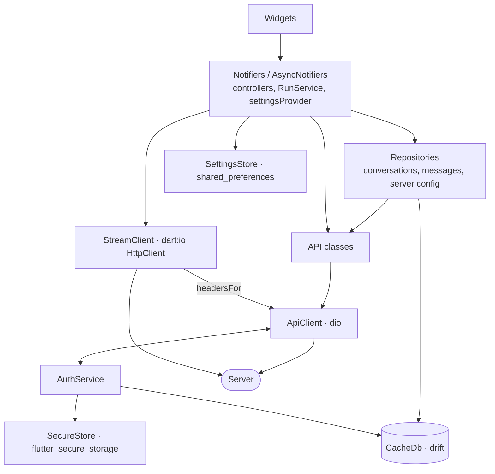
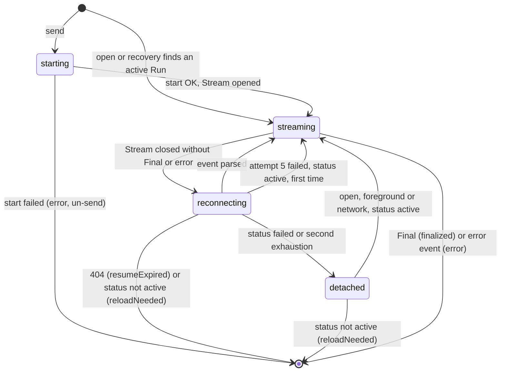

# Design Document

## Overview

The Flutter app in `librechat_flutter/` replaces the KMP_App on Android at feature parity. It talks to an unmodified Server and targets the Target_Version, v0.8.8-rc4. Older servers degrade through the Feature_Gate and a version banner.

- **Reference.** The KMP_App defines behavior and English copy, taken from its `strings.xml` files or from the Kotlin code where it hard-codes text. Its structure is not ported. Quoted copy names its KMP source.
- **Scope.** Android, English, one account, on Flutter 3.44.4 with Dart 3.12.2 (Req 2.5). Deferred: iOS, multi-account and the account switcher, localization, background prefetch and the Prefetch Activity screen, home-screen model and artifact shortcuts (with the Artifact Shortcuts screen, "add to home screen" and `librechat://artifact/{id}`), and the custom accent color picker.
- **Simplicity (Req 1).** One session, no abstract interfaces, plain providers, code generation only for models and the Cache, one request path without interceptors, package defaults, and routes only for screens that exist. KMP mechanisms that serve only multi-account, iOS or rare races are not ported: token epochs, per-account slots, switch resets, proactive-refresh markers and probe latches.
- **Layout.** Architecture and the Core components come first. The Chat and Features parts continue Components and Interfaces.

## Architecture

### Layers



Widgets only watch notifiers. Repositories exist only where the Cache is involved, and other notifiers call API classes (`<area>_api.dart`) directly. Every REST, image and download request goes through `ApiClient.send`. Streams use StreamClient, which shares ApiClient's header builder.

### Folders

```text
lib/                 main.dart (bootstrap); app/ (app.dart, router.dart, routes.dart, shell/)
lib/core/            auth/ config/ images/ log/ models/ network/ storage/ stream/ ui/ (theme/, shared widgets)
lib/features/        chat/{tree,data,run,send,composer,render,artifacts,voice}/, auth/ conversations/ agents/
                     prompts/ projects/ files/ skills/ schedules/ settings/ integrations/
test/                mirrors lib/; support/: property.dart, fakes.dart, test_server.dart, sse_formatter.dart
assets/, android/    icons/providers/*.svg and web/ (Vendored_Web_Assets copies); android/ and ios/ are the only platform folders
```

`features/auth/` holds only screens and controllers. All auth HTTP goes through the one `AuthApi` in `lib/core/auth/`.

### State and dependency injection

- **Singletons.** `main()` builds the core singletons and injects them with `overrideWithValue`. Their providers throw `UnimplementedError` when not overridden. `settingsProvider` (`NotifierProvider<SettingsStore, AppSettings>`) is the exception and uses `overrideWith(() => SettingsStore(prefs))`.
- **Auth state.** `authServiceProvider` is a `ChangeNotifierProvider` from `flutter_riverpod/legacy.dart`. App-level providers that hold per-user data watch `authServiceProvider.select((a) => a.session?.user.id)`, so sign-in, sign-out and expiry rebuild them.
- **Lifetimes.** Screen controllers are `.autoDispose`, with `.family` for ids. Settings, server config, RunService and banners stay alive.
- **Models.** State classes are freezed. API models are freezed plus json_serializable, with `include_if_null: false` (Req 4.6) and `explicit_to_json: true` set in `build.yaml`. Unknown fields are ignored, and each enum has an `unknown` value set through `@JsonKey(unknownEnumValue: …)` (Req 4.7).
- **Errors.** Failures travel as AppException and render through `userMessage(e)`. `ProviderScope(retry: (_, __) => null)` turns off Riverpod 3's automatic retry.
- **Tests.** Tests inject hand-written `implements` fakes from `test/support/fakes.dart` through overrides. There is no mocking package, no service locator and no dio interceptor.

### Navigation

`routerProvider` (`lib/app/router.dart`) is a plain `Provider<GoRouter>` with `refreshListenable: AuthService`, disposed with its provider. Paths come from the existing `Routes` without `splash`, and each route is declared when its screen lands (Req 1.9). Signed-in routes render inside one `ShellRoute` (AppShell), except `/terms` and `/artifact`, which sit on the root navigator.

| Path                                                                                                                                   | Screen                                                                              | Req            |
| -------------------------------------------------------------------------------------------------------------------------------------- | ----------------------------------------------------------------------------------- | -------------- |
| `/server-url`                                                                                                                          | Server_URL_Screen                                                                   | 5, 7, 8        |
| `/login`, `/two-factor`                                                                                                                | Login_Screen, Two_Factor_Screen                                                     | 9, 10, 13.1    |
| `/register`, `/forgot-password`, `/reset-password`, `/verify-email`                                                                    | Register_Screen, Forgot_Password_Screen, Reset_Password_Screen, Verify_Email_Screen | 9.7, 11.1–11.7 |
| `/terms`, `/sso`                                                                                                                       | Terms_Screen, SSO_Screen                                                            | 11.8–11.10, 13 |
| `/chat`, `/chat/c/:conversationId`                                                                                                     | Chat_Screen (landing state, conversation)                                           | 17–32          |
| `/chat/c/:conversationId/media`                                                                                                        | Media_Screen                                                                        | 25.12          |
| `/artifact`                                                                                                                            | Artifact_Viewer, fullscreen                                                         | 24.12–24.14    |
| `/conversations/archived`                                                                                                              | Archived_Screen                                                                     | 16.3–16.4      |
| `/projects`, `/projects/:projectId`                                                                                                    | Projects_Screen                                                                     | 36             |
| `/agents`, `/agents/a/:agentId`, `/agents/new`, `/agents/a/:agentId/edit`                                                              | Agent_Marketplace, Agent_Detail_Screen, Agent_Editor                                | 33, 34         |
| `/prompts`, `/prompts/g/:groupId`, `/prompts/edit`                                                                                     | Prompts_Library                                                                     | 35             |
| `/files`; `/skills`, `/skills/s/:skillId`, `/skills/edit`; `/schedules`, `/schedules/edit`                                             | Files_Manager; Skills_Screen; Schedules_Screen                                      | 37; 38; 39     |
| `/settings` and `/settings/{general,chat,data,account,api-keys,provider-keys,favorites,mcp,memories,presets,shared-links,role-skills}` | Settings_Screen and its sub-screens                                                 | 3, 40–43       |

The redirect runs on every navigation and every AuthService change:

1. **No stored Server_URL.** Go to `/server-url` (Req 7.1).
2. **No session.** While `auth.expired` is set and the location is in the shell, stay put so the AppShell can show the session-expired dialog (Req 14.7). Otherwise keep the auth routes (`/server-url`, `/login`, `/register`, `/forgot-password`, `/reset-password`, `/two-factor`, `/verify-email`, `/sso`) and send everything else to `/login` (Req 7.2).
3. **Session.** An auth route goes to `/chat` (Req 9.5, 12.2). Deep links and shares (Features part) hold their own target while signed out.

AppShell layout (Req 14.1–14.2): below 600 dp it is a `Scaffold` with a modal `Drawer` of `ListTile`s (not a `NavigationDrawer`, whose index-based selection would shift as gated entries come and go), which `ShellMenuButton` opens through the shell's `ScaffoldState` key. From 600 dp it is a `Row` with a 320 dp persistent sidebar, a divider and the screen. Both layouts hold `ShellDrawer`, and banners stack above the screen.

### Startup

`main()` finishes these steps before `runApp`, so the first frame uses the stored theme (Req 3.9) and session (Req 12.2):

1. `WidgetsFlutterBinding.ensureInitialized()`, then `DiagnosticLog.open()`. The log also receives `FlutterError.onError` and `PlatformDispatcher.instance.onError`.
2. `SharedPreferencesWithCache.create(cacheOptions: const SharedPreferencesWithCacheOptions())`.
3. `SecureStore.load()`: one `readAll()` for the Server_URL, the Custom_Headers and the Session.
4. `CacheDb()` plus one query, so the schema check or rebuild (Req 45.4) finishes.
5. `AuthService`, then `ApiClient`, then `auth.api = AuthApi(api)` to close the only dependency cycle, then `auth.load()`.
6. `StreamClient`, `ImageLoader`, and `DynamicColorPlugin.getCorePalette()` for the wallpaper schemes.
7. `runApp(ProviderScope(retry: (_, __) => null, overrides: [...], child: const SwitchboardApp()))`.

After the first frame and on every user change, including sign-in (Req 6.1), `serverConfigProvider` shows the cached Server_Config, endpoints, models and Role_Permissions. It then fetches `GET /api/config`, `/api/endpoints`, `/api/models` and `/api/roles/{user.role}`, and the Server_Version follows from the config. The AppShell loads `GET /api/banner`, plus `GET /api/user/terms` when `interface.termsOfService.modalAcceptance` is set.

### Dependencies

Each package is pinned exactly and added by the task that first imports it (Req 1.6–1.7).

| Package                                                                | Version                            | Purpose                                                                                                    | First used by                                    |
| ---------------------------------------------------------------------- | ---------------------------------- | ---------------------------------------------------------------------------------------------------------- | ------------------------------------------------ |
| flutter_riverpod, go_router                                            | 3.4.3, 17.5.0                      | State and DI with plain providers; navigation                                                              | main.dart, router.dart                           |
| freezed_annotation, json_annotation                                    | 3.1.0, 4.12.0                      | Immutable and JSON models                                                                                  | first model in core/models                       |
| dio, connectivity_plus                                                 | 5.11.1, 7.3.2                      | REST transport; offline indicator                                                                          | ApiClient, onlineProvider                        |
| drift, drift_flutter                                                   | 2.34.4, 0.3.1                      | Cache                                                                                                      | CacheDb                                          |
| shared_preferences, flutter_secure_storage                             | 2.5.6, 11.2.0                      | Settings_Store (`SharedPreferencesWithCache`); Secure_Store                                                | SettingsStore, SecureStore                       |
| path_provider, path, crypto                                            | 2.1.6, 1.9.1, 3.0.7                | Directories; path joins; SHA-256 names of cached image files                                               | DiagnosticLog, ImageLoader                       |
| dynamic_color, flutter_svg                                             | 1.9.0, 2.3.0                       | Wallpaper palette; SVG images and provider icons                                                           | main.dart (Theme), AppImage                      |
| mobile_scanner, webview_flutter                                        | 7.4.2, 4.14.1                      | QR scan; SSO_Screen and WebView_Host, the only WebViews (Req 2.7)                                          | Server_URL_Screen, SSO_Screen                    |
| webview_flutter_android                                                | 4.14.1                             | Turns file and content access off in WebView_Host, which Android allows by default below API 30 (Req 24.9) | WebView_Host                                     |
| gpt_markdown, flutter_math_fork, re_highlight                          | 1.2.1, 0.7.4, 0.0.3                | Markdown; math through `Math.tex` in `latexBuilder`; code highlighting through `codeBuilder`               | MarkdownText, CodeBlock (Chat)                   |
| uuid, intl, url_launcher                                               | 4.6.0, 0.20.3, 6.3.3               | Ids and `new:<uuid>` Run keys; formats; external links                                                     | RunService, MessageView, MarkdownText (Chat)     |
| just_audio, video_player, share_plus, open_filex                       | 0.10.6, 2.14.1, 13.3.1, 4.7.0      | Audio and video parts and Server TTS; share sheet; opening files                                           | ContentPartView, image viewer, file cards (Chat) |
| file_picker, image_picker, mime                                        | 13.1.0, 1.2.4, 2.1.0               | Attachments and `saveFile` exports                                                                         | Composer (Chat)                                  |
| speech_to_text, record, flutter_tts                                    | 7.5.0, 7.1.1, 4.2.5                | Device STT; recording for Server STT; device TTS                                                           | Voice_Service (Chat)                             |
| pdfx                                                                   | 2.11.0                             | PDF preview                                                                                                | PDF preview screen                               |
| flutter_timezone                                                       | 5.1.1                              | Device IANA time zone id for the schedule editor default and chat requests                                 | Schedules editor, RunService                     |
| yaml, qr_flutter, app_links, receive_sharing_intent, package_info_plus | 3.1.4, 4.1.0, 7.2.1, 1.9.0, 10.2.2 | OpenAPI YAML; two-factor QR; `librechat://` links; shares; app version                                     | Features part                                    |
| dev: flutter_lints, build_runner                                       | 6.0.0, 2.15.1                      | Lints (Req 1.11); generator runner                                                                         | analysis_options.yaml, first model               |
| dev: freezed, json_serializable, drift_dev                             | 3.2.5, 6.14.1, 2.34.0              | Model and Cache code generation                                                                            | first model, CacheDb                             |

Not used: permission_handler (each plugin requests its own permissions), photo_view (replaced by InteractiveViewer) and any property-based testing package (replaced by `forAll` in `test/support/property.dart`).

### Changes to the existing foundation

- **pubspec.yaml.** Keep only packages the code imports. Move code generation to the stable set verified on analyzer 10.2.0 (freezed 3.2.5, drift 2.34.4, drift_dev 2.34.0) and gpt_markdown to 1.2.1. Remove riverpod_annotation, riverpod_generator, cached_network_image, mocktail, http_mock_adapter and the stale flutter_math_fork range (it returns pinned at 0.7.4, because MarkdownText imports it).
- **Router and bootstrap.** `router.dart` becomes a plain `Provider<GoRouter>`. Delete `router.g.dart`, the placeholder screen and `Routes.splash`. `main.dart` becomes the bootstrap described above.
- **Theme.** Move `lib/core/theme/` to `lib/core/ui/theme/`. `SwitchboardApp` reads `settingsProvider` and the preloaded wallpaper schemes instead of `DynamicColorBuilder`.
- **Lints.** Use flutter_lints plus only `unawaited_futures`, because a dropped future in network or stream code loses its error. Keep the `*.g.dart` and `*.freezed.dart` excludes, and keep `invalid_annotation_target: ignore` for freezed's `@JsonKey` on parameters. Drop the strict-\* modes and every other rule (Req 1.11).
- **Platforms.** Delete `linux/`, `macos/`, `web/` and `windows/`. Keep `ios/` exactly as generated; no iOS work is done (Req 1.10).
- **Android.** Keep the namespace, applicationId, minSdk 26, label, icons and `network_security_config.xml`, which allows cleartext to every host and trusts only system anchors (Req 2.2–2.4, 46.2). Release builds stay signed with the debug key, as `build.gradle.kts` already does; release signing is out of scope. R8 and resource shrinking stay on (Req 48.1–48.2).
- **Tests and CI.** Replace `test/widget_test.dart` and add `test/support/`. `scripts/ci.sh` builds the release APK (Req 48.5). `build.yaml` is unchanged.

## Components and Interfaces

### Core

#### SettingsStore and AppSettings

_Requirements: 3.2, 3.4–3.6, 3.8–3.9, 6.9, 13.1, 14.6, 17.10, 21.1, 22.9, 24.5, 25.9, 29.1, 32.1–32.7, 40.2–40.7_

The code lives in `lib/core/storage/settings_store.dart`, and `AppSettings` is freezed.

- **Provider.** `settingsProvider` is a `NotifierProvider<SettingsStore, AppSettings>`, and `SettingsStore(this._prefs)` extends `Notifier<AppSettings>`. `build()` falls back to defaults for missing or unknown values. `save(AppSettings next)` writes the changed keys, then sets `state = next`.
- **Persistence.** `SharedPreferencesWithCache` updates its cache synchronously, so a change reaches open screens on the next frame (Req 3.8, 40.4) and persists across restarts (Req 40.5).

| Field                             | Key                                        | Values                                                          | Default            | Req             |
| --------------------------------- | ------------------------------------------ | --------------------------------------------------------------- | ------------------ | --------------- |
| themeMode                         | `theme_mode`                               | system, light, dark                                             | system             | 3.6–3.7         |
| accentSeed                        | `accent_seed`                              | ARGB of one of the 11 presets                                   | `0xFF3B82F6`       | 3.1–3.2         |
| dynamicColor                      | `dynamic_color`                            | bool                                                            | false              | 3.3–3.5         |
| chatFontSize, messageLayout       | `chat_font_size`, `message_layout`         | small/medium/large; thread/twoSided                             | medium; thread     | 22.9            |
| autoScroll, dismissKeyboardOnSend | `auto_scroll`, `dismiss_keyboard_on_send`  | bool                                                            | true               | 17.10, 40.6     |
| duringRunAction                   | `during_run_action`                        | queue, steer                                                    | queue              | 29.1            |
| artifactViewer, inlineArtifacts   | `artifact_viewer`, `inline_artifacts`      | sheet/fullscreen; subset of html, react, svg, mermaid, markdown | sheet; empty       | 24.5, 40.3      |
| slashCommands, sttEnabled         | `slash_commands`, `stt_enabled`            | bool                                                            | true               | 40.7, 32.1      |
| sttEngine, ttsEngine              | `stt_engine`, `tts_engine`                 | device, server; null means the Server default                   | null               | 32.2–32.4, 32.7 |
| ttsVoice, autoReadAloud           | `tts_voice`, `auto_read_aloud`             | Server voice name; bool                                         | null; false        | 32.4, 32.6      |
| forkMode, forkSplitAtTarget       | `fork_mode`, `fork_split_at_target`        | directPath/includeBranches/targetLevel; bool                    | targetLevel; false | 25.9            |
| lastEndpoint, lastModel, lastSpec | `last_endpoint`, `last_model`, `last_spec` | strings; the agent id is the model on the agents endpoint       | null               | 21.1            |
| dismissedBannerIds                | `dismissed_banners`                        | string list                                                     | empty              | 14.6            |
| dismissedVersionBanner            | `dismissed_version_banner`                 | a Server_Version                                                | null               | 6.9             |
| ssoWarningAcknowledged            | `sso_warning_ack`                          | bool                                                            | false              | 13.1            |

Memory personalization (Req 40.8) is not stored here, because it is a Server setting saved through `PATCH /api/memories/preferences`. The Server_URL is also not stored here: it lives in SecureStore with the Custom_Headers, because AuthService owns it (Req 1.2).

#### SecureStore

_Requirements: 1.3, 5.5–5.6, 5.10, 7.6, 12.1, 12.11, 46.1_

`lib/core/storage/secure_store.dart` wraps flutter_secure_storage with default options. It holds three keys: `server_url`, `custom_headers` (JSON) and `session` (JSON with `accessToken`, `refreshToken` and `user`).

- **API.** `Future<void> load()` does one `readAll()`, after which the getters `serverUrl`, `customHeaders` and `session` are synchronous. The writers are `writeServer(url, headers)`, `writeCustomHeaders(headers)`, `writeSession(session)` and `deleteSession()`.
- **Writes.** Each write goes to storage first, and the in-memory copy changes only on success. A failed header write therefore keeps the old set in effect (Req 5.6), and a successful one applies to the next request (Req 5.10).
- **Access.** Only AuthService touches the session (Req 1.3). `AuthService.saveServer` and the Server connection dialog write the Custom_Headers. If `readAll()` throws at startup, the App starts with nothing stored and logs `secure_store_unreadable`.

#### CacheDb

_Requirements: 12.11, 15.5–15.6, 21.6–21.9, 41.1–41.2, 41.4, 45.1–45.4_

`lib/core/storage/cache_db.dart` is a drift database opened with `driftDatabase(name: 'cache')`. Rows hold the Server's JSON, with extra columns only for queries, and times are epoch milliseconds.

| Table           | Columns                                                                     | Holds                                                                   |
| --------------- | --------------------------------------------------------------------------- | ----------------------------------------------------------------------- |
| `conversations` | `id` TEXT PK, `json` TEXT, `updatedAt` INT, `isArchived` BOOL               | Conversation_List and Archived_Screen rows                              |
| `messages`      | `id` TEXT PK, `conversationId` TEXT (indexed), `json` TEXT, `createdAt` INT | Messages of opened conversations                                        |
| `drafts`        | `key` TEXT PK, `text` TEXT, `updatedAt` INT                                 | Composer drafts, keyed by conversation id (`new` for the landing state) |
| `cache_entries` | `key` TEXT PK, `json` TEXT, `updatedAt` INT                                 | `config`, `endpoints`, `models`, `role`, `tags`                         |

- **Schema.** `schemaVersion` is 1. `onUpgrade` drops and recreates every table except `drafts` (Req 45.4), with no migration tooling.
- **Clearing.** `clearAll()` empties all four tables when the session is cleared (Req 12.11). `clearServerData()` keeps `drafts`, and "Clear cache" runs it together with `ImageLoader.clear()` (Req 41.4).
- **Access.** Only the conversations, messages and server config repositories query the database. Temporary chats are never written (Req 21.6).

#### Server URL rules

_Requirements: 4.1, 4.3, 7.3–7.5, 8.1–8.6_

`lib/core/network/server_url.dart` holds three functions:

- `normalizeServerUrl(String input)` returns `({String? url, UrlProblem? problem})`.
- `isServerAuthority(Uri uri, String serverUrl)` compares the scheme, the host (case-insensitively) and the port with defaults filled in. Callers check it on each hop.
- `serverUri(String serverUrl, String path)` appends a path, with any query, to the Server_URL and keeps its subpath. An absolute `http(s)` URL passes through unchanged.

`normalizeServerUrl` runs its checks in the order Req 8.4 lists, so the first reason that applies is the one reported:

1. Trim the input. If it is empty, report `empty`: "Please enter a server URL" (KMP `ServerUrlViewModel.kt`). If it has no `://`, prefix `https://`, so `localhost:3080` becomes `https://localhost:3080`.
2. Split the URL by hand rather than with `Uri.parse`, so each reason stays exact. The scheme is the text before `://`. The authority runs to the first `/`, `?` or `#`. User info up to the last `@` is dropped. The port follows the last `:` outside `[…]`.
3. Lowercase the scheme and the host. If the scheme is not `http` or `https`, report `scheme`: "Use an http:// or https:// URL". If the host is empty, report `host`: "Enter the server's host name".
4. A written port must be all digits, from 1 to 65535. Otherwise report `port`: "Port must be a number from 1 to 65535". A default port (443 for https, 80 for http) is dropped.
5. Drop the query and the fragment, strip every trailing `/`, and keep the rest of the path with its case. The output is `scheme://host[:port]path`, and normalizing it again returns it unchanged (Req 8.6).

The `scheme`, `host` and `port` texts are new, because the KMP_App has no such checks.

#### Custom headers

_Requirements: 5.1–5.8_

The rules live in `lib/core/network/custom_headers.dart`, and the `HeadersEditor` widget lives in `lib/core/ui/`. The functions are `HeaderProblem? validateHeader(String name, String value)`, where `HeaderProblem` is `name`, `reserved` or `value`; `Map<String, String> buildCustomHeaders(Iterable<(String, String)> rows)`; and `String mergeCookieHeader(String? customCookie, String refreshToken)`.

- **Validation.** `validateHeader` trims both fields and reports the first problem that holds, with KMP `core/ui` copy. `name`: the name is empty or has a character outside RFC 7230 `tchar` ("Not a valid header name."). `reserved`: the name is in Reserved_Header_Names ("This header is set by the app and can't be overridden."). `value`: the value has a character outside 0x20–0x7E other than horizontal tab ("This value contains characters that can't be sent.").
- **Rejection.** Editors validate each row whose trimmed name or value is non-empty. A rejection shows under its row, keeps the typed rows, and blocks both the config request and the store (Req 5.3).
- **Building.** `buildCustomHeaders` trims, skips rows that are empty on both sides, and keeps the last row for each name, compared case-insensitively (Req 5.4).
- **Cookie merge.** `mergeCookieHeader` returns `refreshToken=<token>` followed by each trimmed, non-empty `;` segment of the custom value whose name is not exactly `refreshToken`, joined by `; `. The result has exactly one `refreshToken` segment (Req 5.8). The custom `Cookie` header, in any letter case, is then not sent separately.
- **HeadersEditor.** One editor serves both the Server_URL_Screen's Advanced section and the Server connection dialog (Req 5.1). It is titled "Custom request headers" with the KMP description. Each row has a name and a masked value, with "Show value" / "Hide value" and "Remove header", and "Add header" adds a row. The dialog's save shows "Headers saved". A SecureStore failure shows "Couldn't save — storage is unavailable." and keeps the dialog open (Req 5.5–5.6).

#### ApiClient

_Requirements: 4.1–4.7, 4.9–4.10, 5.7–5.10, 6.7, 12.3–12.4, 12.8–12.9, 46.2_

`lib/core/network/api_client.dart` uses one dio instance with `BaseOptions(connectTimeout: Duration(seconds: 10))` and no interceptors. TLS uses Dart's default context, which trusts only the Android system store, and no code sets `badCertificateCallback` (Req 46.2).

```dart
const browserUserAgent = 'Mozilla/5.0 (Linux; Android 14; Pixel 8) AppleWebKit/537.36 '
    '(KHTML, like Gecko) Chrome/131.0.0.0 Mobile Safari/537.36';      // KMP LibreChatHttpClient.kt
class ApiClient {
  ApiClient({required SecureStore secure, required AuthService auth, required DiagnosticLog log});
  final ValueNotifier<Set<Feature>> missingFeatures;
  Future<Response<Object?>> send(String method, String path, {Object? data, Map<String, Object?>? query,
      ResponseType type = ResponseType.json, bool transfer = false, bool followRedirects = true, Feature? feature,
      String? refreshCookie, String? serverUrl, Map<String, String>? customHeaders, ProgressCallback? onSendProgress, CancelToken? cancelToken});
  Future<T> json<T>(String method, String path, T Function(Object? json) decode, {/* same options */});
  Map<String, String> headersFor(Uri uri, {String? refreshCookie, String? serverUrl, Map<String, String>? customHeaders}); // also StreamClient
}
```

`send` works in these steps:

1. **Resolve.** Build the URL with `serverUri(serverUrl ?? auth.serverUrl, path)`, and drop null query values.
2. **Arg_Envelope.** For `POST /api/convos/update`, `POST /api/convos/archive`, `POST /api/convos/pin` and `DELETE /api/convos`, `data` becomes `{"arg": data}` (Req 4.5). Models already omit unset fields (Req 4.6). A route that needs an explicit `null` builds its map by hand.
3. **Hop headers.** `headersFor` always sends `User-Agent: browserUserAgent` (Req 4.2). Only when `isServerAuthority(hop, serverUrl)` holds (Req 4.3) does it add the Custom_Headers (the typed rows when `customHeaders` is passed, Req 5.7), `Authorization: Bearer` while a session exists, and `Cookie`. Where a Refresh_Token applies, `Cookie` is `mergeCookieHeader(customCookie, token)`, with `refreshCookie` on the refresh route and the session's token on `{base}/images/…` (Req 4.4). Elsewhere the custom Cookie goes unchanged. The onboarding probe's `serverUrl` override sends no token.
4. **Send.** Call dio with `followRedirects: false` and `validateStatus: (_) => true`. Unless `transfer` is set (uploads, downloads and images), a 30 s timer cancels the call as a timeout. dio's `receiveTimeout` only bounds gaps between chunks, so it can't enforce this limit (Req 4.9–4.10).
5. **Gateway.** If any response, 3xx included, has a `WWW-Authenticate` value that contains `cloudflare-access` in any case, throw the gateway AppException at once. Don't redirect, retry or refresh (Req 5.9).
6. **Redirects.** Resolve `Location` against the hop and repeat from step 3, for at most 5 hops. A sixth hop fails as malformed. 301–303 switch to GET without a body, while 307 and 308 keep the method and body. With `followRedirects: false`, the 3xx goes back to the caller.
7. **401.** This step applies while a session exists and the path is not `/api/auth/login`, `/register`, `/refresh` or `/2fa/verify-temp`. Await `auth.refresh()`, unless the Access_Token changed since sending, then repeat from step 3 once, with FormData bodies `clone()`d. A second 401 returns to the caller as a server AppException, and the session stays (Req 12.3, 12.9). A refresh failure propagates (Req 12.8).
8. **Map.** A 2xx returns. A 404 with `feature` set and no JSON `message` or `error` adds the feature to `missingFeatures` and throws `unsupported` (Req 6.7). Any other status of 400 or more, or a 3xx that can't be followed, throws `server`. dio connection errors and connect timeouts throw `network`.
9. **Log.** Write one line with the method, the path without its query, the status, the duration and the hop count.

`json` decodes with the given `fromJson`. A `FormatException`, `TypeError` or `CheckedFromJsonException` becomes `malformed`. Unknown fields and enum values never fail decoding (Req 4.7).

#### AppException and userMessage

_Requirements: 4.9–4.11, 5.9, 6.7, 12.7_

`lib/core/network/app_exception.dart` defines three things:

- `enum FailureKind { network, timeout, malformed, gateway, server, unsupported, sessionExpired, unknown }`
- `AppException(this.kind, {this.status, this.message, this.signedIn = true})`, which implements `Exception`
- `String userMessage(Object error)`

`message` keeps the body's `message`, `error` or `error_message` only when that text reads as a sentence, using the test from KMP `looksLikeUserMessage`. After trimming, the text must be at most 200 characters, contain no `<`, `>`, CR, LF or `://`, and have no run longer than 40 characters without a space. The copy comes from KMP `FailureMessages.kt`, `LibreChatHttpClient.kt` (status fallbacks), `ConfigRepositoryImpl.kt` (signed-out gateway), the settings string `api_keys_not_supported` and the shared string `session_expired_message`.

| Case                        | Text shown                                                                                                                                                                                                        |
| --------------------------- | ----------------------------------------------------------------------------------------------------------------------------------------------------------------------------------------------------------------- |
| server, with `message`      | That text                                                                                                                                                                                                         |
| server, by status           | 400: "Bad request". 403: "Access denied". 404: "Not found". 429: "Too many requests. Please try again later." 5xx: "Server error. Please try again later." Other: "Request failed (HTTP {status})"                |
| network                     | "Network unavailable. Check your connection."                                                                                                                                                                     |
| timeout                     | "The server took too long to respond."                                                                                                                                                                            |
| malformed                   | "Unexpected response from the server."                                                                                                                                                                            |
| gateway                     | Signed in: "Your server's access gateway rejected this request. Check Server connection in Settings." Signed out: "Your server's access gateway rejected this request. Check the gateway headers under Advanced." |
| unsupported                 | "This feature is not supported on your server version."                                                                                                                                                           |
| sessionExpired              | "Your session has expired. Sign in again to continue."                                                                                                                                                            |
| unknown, or any other error | "Something went wrong. Please try again."                                                                                                                                                                         |

#### AuthService

_Requirements: 1.2–1.3, 7.9, 9.3–9.8, 9.10, 10.1–10.3, 11.10, 12.1–12.11, 13.6_

`lib/core/auth/auth_service.dart` holds the service. All of its HTTP goes through `AuthApi` (`lib/core/auth/auth_api.dart`), which covers login, two-factor, refresh, logout, user, register, password reset, verify-resend and terms.

```dart
class Session { final String accessToken; final String refreshToken; final User user; }  // hand-written JSON
sealed class LoginResult {}   // SignedIn, NeedsTwoFactor(tempToken), NeedsVerification
class AuthService extends ChangeNotifier {
  late AuthApi api;                                    // set once in main()
  String? get serverUrl;  Session? get session;  bool get expired;
  bool openIdAutoRedirected = false;                   // Req 9.10: once per process
  Future<void> load();  Future<void> saveServer(String url, Map<String, String> headers);
  Future<LoginResult> login(String identifier, String password);
  Future<void> verifyTwoFactor(String tempToken, String code, {required bool backupCode});
  Future<void> exchangeSsoToken(String refreshToken);
  Future<void> refresh();                              // single flight: one shared Future (Req 12.4)
  Future<void> signOut();  void acknowledgeExpiry();
}
```

- **Login.** `login` sends `{email: identifier, password}` to `/api/auth/login`, and LDAP usernames use the same field. A `token` with a `refreshToken` Set-Cookie stores the Session (Req 9.4). `twoFAPending` with a `tempToken` returns `NeedsTwoFactor` (Req 9.6). The message `Email not verified.` returns `NeedsVerification` (Req 9.7). Anything else throws with the Server's message (Req 9.8). A `token` without the cookie counts as malformed, because that session could never refresh.
- **Two-factor.** `POST /api/auth/2fa/verify-temp` sends `{tempToken, token: code}`, or `{tempToken, backupCode: code}` for a backup code. Success stores the Session the same way login does (Req 10.1–10.3).
- **SSO exchange (Req 13.6).** Refresh with the captured token, and keep the rotated cookie if one comes back, or the captured token otherwise. Hold the Session in memory without notifying, load `GET /api/user`, then store the Session and notify. Any failure drops it.
- **Refresh.** `POST /api/auth/refresh` carries only the `refreshToken` cookie (Req 12.5) and uses `followRedirects: false`. A pure function, `classifyRefresh(status, body, location, serverUrl)`, picks the outcome:

| Response                                                                                                                                                                                                                                                                     | Outcome                                                                                           |
| ---------------------------------------------------------------------------------------------------------------------------------------------------------------------------------------------------------------------------------------------------------------------------- | ------------------------------------------------------------------------------------------------- |
| 2xx with `token`                                                                                                                                                                                                                                                             | Success. Store `token`, the rotated cookie (or the old token) and the returned `user` (Req 12.6). |
| 401 or 403 whose body contains `Invalid refresh token`, `Invalid OpenID refresh token`, `No session found`, `Refresh token expired or not found for this user` or `OPENID_SESSION_MISSING`; 200 with the body `Refresh token not provided`; or a 3xx to `{Server_URL}/login` | LibreChat_Refresh_Rejection. Clear the session with `expired` set (Req 12.7).                     |
| Anything else: a network error, timeout, 5xx, Access_Gateway_Error, other 403, 2xx without `token`, or other 3xx                                                                                                                                                             | Keep the session. Waiting requests fail with this error (Req 12.8).                               |

- **Sign-out.** Call `POST /api/auth/logout`, then clear the session whatever the result (Req 12.10). A rejection during sign-out clears the session without setting `expired`. Declining the terms also signs out (Req 11.10).
- **Clearing.** Delete the Session, run `CacheDb.clearAll()`, keep the Server_URL and Custom_Headers, and notify (Req 12.11). `saveServer` with a different URL clears first (Req 7.9). `expired` stays set until `acknowledgeExpiry()` (Req 14.7).
- **Token access.** Other code reads tokens only through `session`, and only AuthService writes them (Req 1.3).

#### Auth screens

_Requirements: 5.1, 5.3, 5.7, 7.1–7.9, 8.5, 9, 10, 11, 13_

Screens and controllers live in `lib/features/auth/`, and `OtpField` lives in `lib/core/ui/`.

| Screen                 | Server calls                                                                    | Behavior and copy                                                                                                                                                                                                                                                                                                                                                                                                        | Req                   |
| ---------------------- | ------------------------------------------------------------------------------- | ------------------------------------------------------------------------------------------------------------------------------------------------------------------------------------------------------------------------------------------------------------------------------------------------------------------------------------------------------------------------------------------------------------------------ | --------------------- |
| Server_URL_Screen      | `GET /api/config` with the typed URL and rows, and no token                     | Normalize, then validate the rows. For `http://`, show "Insecure connection" ("Connect anyway" / "Cancel"). On failure, show the reason and keep the input. On success, call `auth.saveServer`, cache the config and open `/login`. The "Advanced" section holds HeadersEditor and opens expanded when headers are stored. A QR scan fills the field. "Change server" opens the screen with the stored values filled in. | 5.1, 5.3, 5.7, 7, 8.5 |
| Login_Screen           | `serverConfigProvider`, login                                                   | The identifier is labelled "Username" when `ldap.username` is set. There is one button per enabled social provider, with the config label and image for OpenID and SAML. `openidAutoRedirect` starts OpenID once per process. Links follow `registrationEnabled` and `passwordResetEnabled`. The first social sign-in shows "Sign in with an in-app browser?" with the KMP body.                                         | 9, 13.1               |
| Register_Screen        | `POST /api/auth/register` `{name, username, email, password, confirm_password}` | Before sending, show field errors for a password shorter than `minPasswordLength` or a mismatched confirmation. On success, show the Server's message and open `/login`.                                                                                                                                                                                                                                                 | 11.1–11.3             |
| Forgot_Password_Screen | `POST /api/auth/requestPasswordReset` `{email}`                                 | Show the Server's message. A `link` in the response opens `/reset-password` with its `token` and `userId`.                                                                                                                                                                                                                                                                                                               | 11.4–11.5             |
| Reset_Password_Screen  | `POST /api/auth/resetPassword` `{userId, token, password, confirm_password}`    | On success, open `/login`.                                                                                                                                                                                                                                                                                                                                                                                               | 11.6                  |
| Verify_Email_Screen    | `POST /api/user/verify/resend` `{email}`                                        | Disable resend for 60 s after each request, with a countdown.                                                                                                                                                                                                                                                                                                                                                            | 9.7, 11.7             |
| Two_Factor_Screen      | `POST /api/auth/2fa/verify-temp`                                                | OtpField takes 6 digits, and a toggle switches to backup-code entry. On failure, show the Server's message and stay on the screen.                                                                                                                                                                                                                                                                                       | 10                    |
| Terms_Screen           | `GET /api/user/terms`, `POST /api/user/terms/accept`                            | Show `interface.termsOfService.modalContent`. Accept opens `/chat`, and Decline calls `signOut()`.                                                                                                                                                                                                                                                                                                                       | 11.8–11.10            |
| SSO_Screen             | WebView `{Server_URL}/oauth/{provider}`, refresh, `GET /api/user`               | Run the flow below. Closing returns to `/login` (Req 13.8).                                                                                                                                                                                                                                                                                                                                                              | 13                    |

The SSO flow is ported from KMP `SsoWebView.android.kt` and `SsoNavigationGate.kt`:

1. Create a `WebViewController` with JavaScript on, and set `setUserAgent` to KMP `SSO_ANDROID_USER_AGENT`: `Mozilla/5.0 (Linux; Android 10; K) AppleWebKit/537.36 (KHTML, like Gecko) Chrome/138.0.0.0 Mobile Safari/537.36` (Req 13.3).
2. Await `WebViewCookieManager().clearCookies()`, then load `{Server_URL}/oauth/{provider}` (Req 13.2).
3. The gate arms on a main-frame navigation to `{Server_URL}/oauth/{provider}/callback`, matching the whole path segment and comparing the host case-insensitively. The next main-frame navigation to the Server_Authority returns `NavigationDecision.prevent` and finishes the flow (Req 13.4). Both `onNavigationRequest` and `onUrlChange` feed the gate.
4. On the Server_Authority, `onPageFinished` and `onUrlChange` also look for `refreshToken` in the cookie jar. This covers form_post providers (Apple, SAML), whose POST callback the gate never sees.
5. Finishing runs once. It reads `refreshToken` with `WebViewCookieManager.getCookies` for the Server_URL, calls `clearCookies()` to expire it (Req 13.5), loads `about:blank`, and hands the token to `auth.exchangeSsoToken`.
6. These cases show "Sign-in failed. Please try again." with Retry, which restarts at step 2 (Req 13.7): the flow returns to the Server without a token, a main-frame load errors, the Server_Authority returns an HTTP error, or the URL carries an `error` query parameter.

#### Feature_Gate and Server_Version

_Requirements: 6.1–6.7, 14.3, 45.2–45.3_

`lib/core/config/server_config.dart` holds two pieces:

- `ConfigRepository` reads and writes the `config`, `endpoints`, `models` and `role` cache entries. Its `probe(url, headers)` serves the Server_URL_Screen.
- `serverConfigProvider` is an AsyncNotifier of `ServerInfo`, which holds the StartupConfig, the EndpointConfig map, the models, RolePermissions, the Server_Version and `refreshError`. It shows the cache, then fetches. A failed fetch keeps the cache and sets `refreshError` (Req 6.2, 45.3). While signed out, it loads only `/api/config`, for the Login_Screen.

`lib/core/config/server_version.dart` derives the Server_Version:

- **Parsing and order.** `Version.parse` accepts `v?MAJOR.MINOR.PATCH(-PRE)?(+BUILD)?` and drops the build part. Versions follow semantic versioning precedence, so a prerelease comes before its release (Req 6.4). Prerelease identifiers also split between letters and digits, so `rc4` becomes `rc` and `4`, and `rc9 < rc10`.
- **Target.** `targetVersion` is 0.8.8-rc4. A test checks it against the `tag=` line of the repository's `UPSTREAM_VERSION`.
- **Server_Version.** It is the Server_Config `version` if present. Otherwise it is the tag in `releaseCommits` whose commit matches `buildInfo.commit`, where a prefix of at least 7 hex characters counts as a match. Otherwise it is unknown.
- **releaseCommits.** This is a const map from commit to tag. The implementing task generates it once from the `v*` GitHub tags of `danny-avila/LibreChat` with `gh api repos/danny-avila/LibreChat/tags --paginate --jq '.[] | "\(.commit.sha) \(.name)"'`, and regenerates it when the Target_Version moves.

`lib/core/config/feature_gate.dart` holds `enum Feature`, `FeatureGates.has(Feature)` and `featureGatesProvider`. The provider derives each gate from `serverConfigProvider` and from `ApiClient.missingFeatures`, which it listens to (Req 6.3).

| Feature                                                                                                                                      | Server_Config                                      | Role_Permissions (USE)                                           | Endpoint or minimum version                     |
| -------------------------------------------------------------------------------------------------------------------------------------------- | -------------------------------------------------- | ---------------------------------------------------------------- | ----------------------------------------------- |
| `prompts`, `bookmarks`, `memories`, `mcpServers`, `skills`, `temporaryChat`, `multiConvo` (Comparison), `webSearch`, `runCode`, `fileSearch` | `interface.<feature>`                              | The same name in upper snake case (`MCP_SERVERS`, `RUN_CODE`, …) |                                                 |
| `agents`                                                                                                                                     | `interface.agents`                                 | `AGENTS`                                                         | `agents` endpoint present                       |
| `marketplace`                                                                                                                                | `interface.marketplace`                            | `MARKETPLACE`                                                    | `agents` is on                                  |
| `schedules`                                                                                                                                  | `interface.schedules` (absent means off)           | `SCHEDULES`                                                      |                                                 |
| `sharedLinks`, `apiKeys`                                                                                                                     | `sharedLinksEnabled`, `interface.remoteAgents`     | `SHARED_LINKS`, `REMOTE_AGENTS`                                  |                                                 |
| `presets`, `parameters`, `endpointsMenu`, `modelSelect`, `feedback`, `contextUsage`                                                          | `interface.<feature>`                              |                                                                  |                                                 |
| `traceViewer`, `balance`                                                                                                                     | `interface.traceViewer.enabled`, `balance.enabled` |                                                                  |                                                 |
| `projects`                                                                                                                                   |                                                    |                                                                  | v0.8.7-rc1                                      |
| `pin`, `quotes`                                                                                                                              |                                                    |                                                                  | v0.8.7                                          |
| `steering`, `toolFavorites`                                                                                                                  |                                                    |                                                                  | v0.8.8-rc1                                      |
| `serverQueue`, `archiveAll`, `memoryById`                                                                                                    |                                                    |                                                                  | v0.8.8-rc2 (`memoryById` also needs `memories`) |

- **Flags.** An absent `interface` flag counts as on, which is the Server's default. `schedules` and `traceViewer` are the exceptions. Object-valued flags are off only as `false` or `{use: false}`, and `traceViewer` needs `enabled: true`.
- **Permissions and versions.** Until Role_Permissions load, USE counts as granted, and the Server still enforces it. Minimum versions compare against the Server_Version, or against the Target_Version while the Server_Version is unknown (Req 6.5–6.6).
- **404 rule (Req 6.7).** Calls behind a feature pass `feature:`. A 404 without a JSON `message` or `error` is Express's "Cannot GET", not LibreChat's item-not-found, so it hides the feature until restart. The call fails with the `unsupported` text.
- **Always offered.** New chat, archived conversations, the Files_Manager and the Settings_Screen.

#### AppShell

_Requirements: 6.8–6.10, 11.8, 14.1–14.8_

`lib/app/shell/` holds `AppShell`, `ShellDrawer`, `ShellMenuButton` and the banners.

- **Entries (Req 14.3).** New chat, Archived, Agents (`marketplace`), Prompts (`prompts`), Files, Skills (`skills`), Schedules (`schedules`) and Settings, with the KMP drawer labels. Entries without a gate are always shown. The Chats | Projects switch and the Conversation_List come from the Features part. Below 600 dp, a tap closes the drawer and then navigates.
- **Banners and offline indicator (Req 14.8).** Banners are full-width cards in a polite live region, stacked as offline, then server, then version. `onlineProvider` in `lib/core/network/connectivity.dart` is a StreamProvider over connectivity_plus. It reports offline when the only result is `none`, and the banner then shows "No internet connection" (KMP `app` strings).
- **Server banner (Req 14.4–14.6).** `bannerProvider` loads `GET /api/banner` for each user. It shows `message` as plain text when `bannerId` and `message` are set and the id is not in `dismissedBannerIds`. A persistable banner has no close button and stays for as long as the Server returns it. Closing any other banner ("Dismiss banner") stores its id.
- **Version banner (Req 6.8–6.10).** It shows when the Server_Version is known, its major.minor.patch differs from the Target_Version's, and it isn't `dismissedVersionBanner`. The text is "This app was built for LibreChat v{target}, but your server is running v{server}. Some features may not work correctly." (KMP `version_mismatch_message`). "Dismiss" hides it for this launch, and "Don't show again" stores the version. The KMP dialog says "Don't warn again", but the App uses the Req 6.9 label because it shows a banner, not that dialog.
- **Session expired (Req 14.7).** When `auth.expired` turns true, a non-dismissible dialog shows "Signed out" / "Your session has expired. Sign in again to continue." with "Dismiss" (KMP `shared` strings). The button, or back, calls `auth.acknowledgeExpiry()`, and the redirect then opens `/login`.
- **Terms (Req 11.8).** When `interface.termsOfService.modalAcceptance` is set and `GET /api/user/terms` reports `termsAccepted: false`, the shell goes to `/terms`.

#### ImageLoader and AppImage

_Requirements: 4.2–4.4, 23.4–23.5, 41.4_

- **API.** `ImageLoader(ApiClient api, Directory dir)` lives in `lib/core/images/image_loader.dart`, with `dir` set to `<app cache>/images`. It offers `Future<Uint8List> load(String url)` for a Server-relative path or an absolute URL, and `Future<void> clear()` for memory and files. `AppImage(url, {fit, width, height, semanticLabel})` is a StatefulWidget in `app_image.dart`.
- **Lookup.** `load` tries the memory LRU (64 MB), then `<dir>/<sha256(url)>`, then `ApiClient.send('GET', url, type: ResponseType.bytes, transfer: true)`. Concurrent loads of one URL share one Future. `data:` URIs decode in place and are not cached.
- **Auth.** Headers are built per hop, so the bearer and the `refreshToken` cookie reach only `{Server_URL}/images/…` on the Server_Authority. Other hosts get only the Browser_User_Agent (Req 4.2–4.4).
- **Rendering.** `AppImage` keeps one Future per URL. Bytes that start with `<svg` or `<?xml` (after any whitespace) render with `SvgPicture.memory`, and all others with `Image.memory`. It shows a neutral box while loading, and on failure a broken-image icon with the semantic label.
- **Clearing.** `clear()` serves "Clear cache" (Req 41.4). Nothing expires on its own.

#### DiagnosticLog

_Requirements: 41.5, 46.3–46.4_

- **API.** `lib/core/log/diagnostic_log.dart` offers `static Future<DiagnosticLog> open()`, which opens `<app support dir>/diagnostic.log`. Logging uses `info(tag, event, [attrs])` and `error(tag, event, error, [stack])`. `Future<File> file()` flushes the log for the Data settings export (Req 41.5).
- **Entries.** Each entry is one line holding the UTC time, the level, the tag, the event and `key=value` attributes.
- **What is logged (Req 46.3).** Event names, method, path without query or fragment, status, duration, hop count, FailureKind and ids. Tokens, cookie values, Custom_Headers values, passwords, and message or prompt text are never logged.
- **Redaction.** `redact()` runs on every attribute. Keys matching `token|cookie|authorization|password|secret|header|content|text|message|prompt` become `[redacted]`. URLs lose their query and fragment, and JWT-shaped strings, `Bearer …` and `refreshToken=…` are replaced. Strings stop at 200 characters. Errors are logged by type, FailureKind and status, never through `toString()`, because dio messages embed URLs and headers.
- **Size.** Appends run in order through one Future chain. When the file passes 1 MB, it is rewritten to its newest 768 KB, starting at a line boundary, so it never holds more than the newest 1 MB (Req 46.4).

#### Theme

_Requirements: 3.1–3.9, 47.1–47.4_

- **Files.** `lib/core/ui/theme/accent_colors.dart` keeps the 11 presets in KMP order, with Blue `#3B82F6` first. `app_theme.dart` keeps `AppTheme.build` (a tonal-spot `ColorScheme.fromSeed` with the KMP shapes and type scale) and `isSurfaceDark`.
- **Theme choice.** `SwitchboardApp` sets `themeMode`. It builds `theme` and `darkTheme` from the wallpaper schemes when `dynamicColor` is on and the device provides them, and from `accentSeed` otherwise. System mode follows the device (Req 3.7), and MaterialApp's 200 ms theme animation meets Req 3.8.
- **Wallpaper schemes.** `main()` awaits `DynamicColorPlugin.getCorePalette()` once, and `wallpaperSchemesProvider` in `app_theme.dart` provides the result. The palette is null below Android 12, which hides "Use wallpaper colors" (Req 3.4). This replaces `DynamicColorBuilder`, which has no palette on its first build and would paint the first frame in accent colors, breaking Req 3.9.
- **Accessibility.** Icon-only controls are `IconButton`s with a `tooltip`, which is also their semantic label (Req 47.1). Material 3 defaults keep tap targets at 48 dp, and custom tappables set `minimumSize: Size(48, 48)` (Req 47.2). Body text uses `onSurface` and `onSurfaceVariant` on surface roles, and a test checks a 4.5:1 contrast ratio for every preset in both brightnesses (Req 47.3). Nothing fixes `MediaQuery.textScaler`, so the chat font size setting scales on top of the system font size (Req 47.4).

### Chat

All chat code lives in `lib/features/chat/`. The Composer builds a `ChatTurn`, a freezed class with `kind`, `text`, `files`, `quotes`, `selection`, `addedSelection`, `tools`, `mcpServers`, `params`, `isTemporary` and the message the turn acts on. RunService runs the turn and owns all live state. The Chat_Screen renders the Active_Path of the stored messages, plus the Run's Optimistic_Message and live reply. `ChatSelection` holds `endpoint`, `endpointType`, `model`, `agentId`, `spec` and `modelLabel`.

Chat reads these AppSettings fields (see SettingsStore and AppSettings): `chatFontSize`, `messageLayout`, `autoScroll`, `dismissKeyboardOnSend`, `duringRunAction`, `artifactViewer`, `inlineArtifacts`, `slashCommands`, `sttEnabled`, `sttEngine`, `ttsEngine`, `ttsVoice`, `autoReadAloud`, `forkMode`, `forkSplitAtTarget`, `lastEndpoint`, `lastModel` and `lastSpec`. `Feature` members are those of the Feature_Gate table.

#### Message_Tree and messages

_Requirements: 17.1–17.7, 18.10, 21.6–21.8, 25.14_

```dart
// tree/message_tree.dart (pure)
const rootParentId = '00000000-0000-0000-0000-000000000000';
List<Message> activePath(List<Message> messages, Map<String, String> selection, {String? anchorId});
List<Message> siblingsOf(List<Message> messages, Message m);          // oldest → newest
Map<String, String> selectSibling(List<Message> path, int index, String siblingId);
```

- **Roots.** Messages are deduplicated by `messageId`. A message is a root when its `parentMessageId` is the Root_Parent_Id, is empty, or names no message in the set. All roots are Siblings under the key `rootParentId`.
- **Newest-sibling default.** Siblings sort by `createdAt`, ties keep list order, and the last is the newest. The walk starts at `rootParentId`. At each level it takes `selection[key]` when that names a child, otherwise the newest child, and continues from the chosen id. A visited set stops it on malformed data. The result is a chain from a root by construction (Req 17.5 property target).
- **Anchor.** While a Run is live, `anchorId` forces the walk through the anchor's ancestors and ends the path at the anchor, and the live reply renders as the anchor's child. The anchor is the Optimistic_Message for send and edit (an edit's is a new Sibling of the edited message), the parent user message for regenerate and edit-AI, the reply itself for continue, and the Active_Path leaf for compact and attach.
- **Navigator.** SiblingNavigator shows "n/m" with previous and next on each path message whose level holds more than one message, and is disabled during a Run. `selectSibling` keeps only the path's choices above `index` plus the new Sibling, so every lower level falls back to its newest Sibling (Req 17.7).

```dart
// data/messages_repository.dart
class MessagesRepository {
  Stream<List<Message>> watch(String conversationId);   // CacheDb.messages rows → Message.fromJson
  Future<List<Message>> fetch(String conversationId);   // MessagesApi.list; replaces the cached rows in one transaction
  Future<void> upsert(String conversationId, List<Message> messages);
  Future<String?> draft(String key); Future<void> saveDraft(String key, String text); Future<void> deleteDraft(String key);
}
```

`conversationMessagesProvider(conversationId)` is an `AsyncNotifierProvider.autoDispose.family`. Its state is `ConversationMessages {messages, selection, localIds, justSettledId, refreshing}`.

- **Cache first (Req 17.1).** `build` listens to `watch`, and a non-empty first emission becomes data at once with `refreshing: true`. Then `fetch` runs, and its result becomes data even when empty, so a zero-message conversation settles instead of waiting for a cache emission that never comes. Later emissions replace `messages`.
- **Loading (Req 17.2).** The spinner shows only while the state is loading and the conversation has no Run, so a just-created chat keeps its Optimistic_Message and live reply on screen (Req 18.10). A failed fetch keeps cached rows and shows a banner. With no rows, the state is an error with Retry.
- **Temporary chats (Req 21.6).** When `RunService.isTemporary(id)` is true, the notifier skips `watch`, `upsert`, the row replacement and drafts, and messages live only in memory.
- **Local messages.** `localIds` marks messages the Server never confirmed, such as an Optimistic_Message and partial reply kept after an error or abort fallback. They are never cached. The next send's parent is the last Active_Path message outside `localIds`, or the Root_Parent_Id.
- **Methods.** `applyFinal(FinalTurn)`, `addLocal(List<Message>)`, `upsertMessage(Message)`, `select(Map<String, String>)`, `reload()`.

#### SSE_Parser, StreamEvent, EventMapper and StreamClient

_Requirements: 18.3–18.6, 19.1–19.3, 19.5_

`SseParser` (`StreamTransformer<List<int>, SseEvent>`) follows the WHATWG rules:

- **Bytes and lines.** A chunked UTF-8 decoder keeps multibyte characters intact when a chunk splits them, and one leading BOM is stripped. Lines end at CRLF, LF or CR. A CR at the end of a chunk waits for the next chunk to see whether an LF follows.
- **Fields.** A line starting with `:` is a comment. Any other line is `field:value`, with one leading space removed from the value; a line with no `:` has an empty value. `data` appends the value plus LF, `event` sets the name, and `id` sets the id unless the value contains NUL. `retry` and unknown fields are ignored.
- **Dispatch.** A blank line dispatches when at least one `data` line was seen, with the final LF removed, then resets the buffers. `event` is null when absent. `id` belongs to its own event, with no carried-over last-event-id, because the App never sends `Last-Event-ID`. A partial event at end of stream is dropped.
- **Round trip (Req 18.5).** `test/support/sse_formatter.dart` writes events with random CR, LF and CRLF endings, interleaved comments, and one `data:` line per LF. The bytes are split into chunks at random offsets, including inside CRLF pairs and UTF-8 sequences. Generated data uses LF breaks only, and names and ids contain no line breaks or NUL.

`stream_events.dart` declares `sealed class StreamEvent`. Its subclasses are the wire events below plus four that StreamClient emits: `StreamReconnecting(attempt)`, `StreamExpired` (HTTP 404), `StreamRetryExhausted` and `StreamFailed(AppException)` (refresh rejected).

`EventMapper.map(SseEvent) → List<StreamEvent>` keeps one instance per Run, across reconnects. Blank data, `[DONE]` and empty deltas yield nothing. Data that is not a JSON object is logged to the Diagnostic_Log and skipped, so one bad frame never ends a Run. Dispatch order:

| #   | Wire frame                                                                 | StreamEvent(s)                                                                                                                                                                                                                                                  |
| --- | -------------------------------------------------------------------------- | --------------------------------------------------------------------------------------------------------------------------------------------------------------------------------------------------------------------------------------------------------------- |
| 1   | SSE `event: attachment` or `librechat:attachment`                          | `AttachmentEvent(Attachment)` from the data object: file fields, `toolCallId`, the office preview fields `status`/`text`/`textFormat`/`previewError`, and `web_search`/`file_search`/`memory` payloads                                                          |
| 2   | `{"sync": true, resumeState, pendingEvents}`                               | `SyncSnapshot(resumeState.aggregatedContent)`; `PendingActionEvent` when `resumeState.pendingAction` has an `actionId`; `SteersSynced(resumeState.pendingSteers ?? [])`, always (absent means none); then each `pendingEvents[]` object mapped through rows 3–7 |
| 3   | `{"final": true, …}`                                                       | `FinalEvent(conversation, requestMessage, responseMessage ?? message, aborted, earlyAbort, pendingSteers)`                                                                                                                                                      |
| 4   | `created` key (a `{message}` object, or `true` with a top-level `message`) | `CreatedEvent(conversationId, messageId, parentMessageId)`                                                                                                                                                                                                      |
| 5   | `error` key (string or object)                                             | `StreamError(text)`                                                                                                                                                                                                                                             |
| 6   | `{event, data}` (LangGraph)                                                | by name, in the table below                                                                                                                                                                                                                                     |
| 7   | Legacy flat `{type, …}`                                                    | `content`/`text` → `TextDelta`; `thinking`/`think` → `ThinkDelta`; `tool_call_start`/`tool_call_complete` → tool events; otherwise a string `text` or `response` → `TextDelta`; else nothing                                                                    |

| LangGraph `event`                                                                                                      | StreamEvent                                                                                                    |
| ---------------------------------------------------------------------------------------------------------------------- | -------------------------------------------------------------------------------------------------------------- |
| `on_message_delta`                                                                                                     | `TextDelta`: joined `data.delta.content[type=text].text`                                                       |
| `on_reasoning_delta`                                                                                                   | `ThinkDelta`: joined `…[type=think].think`                                                                     |
| `on_run_step`                                                                                                          | `ToolCallStarted` from `stepDetails.tool_calls[0]` (`id`, `name`, `args`); every step also records attribution |
| `on_run_step_completed`                                                                                                | `ToolCallCompleted(result.tool_call.id, output)`                                                               |
| `on_run_step_closed`                                                                                                   | `ToolCallClosed(toolCallId from the step map, status)`                                                         |
| `on_summarize_complete`                                                                                                | `SummaryEvent` (text parts of `data.summary.content`)                                                          |
| `on_subagent_update`                                                                                                   | `SubagentUpdate(phase, parentToolCallId, subagentRunId, subagentType, label)`                                  |
| `attachment` / `title`                                                                                                 | `AttachmentEvent` / `TitleEvent(conversationId, title)` (a blank title is dropped)                             |
| `on_token_usage` / `on_context_usage`                                                                                  | `TokenUsageEvent` / `ContextUsageEvent`                                                                        |
| `on_pending_action`                                                                                                    | `PendingActionEvent` (dropped without an `actionId`)                                                           |
| `on_steer_applied`                                                                                                     | `SteerApplied(steerId, clientSteerId, index, part)` (dropped without a `steerId`)                              |
| `on_run_step_delta`, `on_chat_model_end`, `on_agent_update`, `on_summarize_start`, `on_summarize_delta`, unknown names | nothing (Req 18.6)                                                                                             |

**Step-to-agent attribution.** Each `on_run_step` records `stepId → agentId` (from `data.agentId` or `data.metadata.agentId`) and `stepId → toolCallId`, and the mapper remembers the last announced agent. Every content event gets `agentId = its own agentId ?? stepAgent[data.id] ?? stepAgent[data.result.id] ?? lastAgentId`. Comparison panes depend on this because two agents' steps interleave.

`StreamClient.open(String streamId, EventMapper mapper, {bool resume = false}) → Stream<StreamEvent>`:

- **Request.** `GET /api/agents/chat/stream/{streamId}`, with `?resume=true` when `resume` is set and on every reconnect. Headers come from ApiClient's header builder plus `Accept: text/event-stream`. `followRedirects` is false, and there is no response timeout.
- **Responses.** On 2xx, bytes go through SseParser and the mapper. Each parsed SseEvent resets the attempt count (Req 19.3), and the Dart stream completes after a `FinalEvent` or `StreamError`. On 401 the client refreshes once through AuthService and retries the same attempt; a rejected refresh yields `StreamFailed`. On 404 it yields `StreamExpired` and completes (Req 19.5).
- **Reconnect ladder (Req 19.1, 19.2).** Anything else counts as a failed attempt: a body that ends without a Final or error, an IO error, or another status. The client yields `StreamReconnecting(n)` and reconnects after 1, 2, 4, 8 and 8 s for attempts 1–5 (tests shorten these through the `backoff` constructor parameter and run against `test/support/test_server.dart`). When attempt 5 fails, it yields `StreamRetryExhausted` and completes, and RunService decides what happens next. Cancelling the subscription closes the socket.

#### RunService and RunState

_Requirements: 18.1–18.3, 18.7–18.14, 19.4–19.9, 20.1–20.8, 21.9–21.11_

```dart
// run/run_state.dart
enum RunPhase { starting, streaming, reconnecting, detached }
enum TurnKind { send, edit, regenerate, editAi, continued, compact, attach }
@freezed class RunState { String key; String? conversationId; String? streamId; String? requestMessageId;
  int? generationCreatedAt; TurnKind kind; ChatSelection selection; bool isTemporary; bool isComparison;
  bool firstRunOfNewChat; Message? optimistic; String? anchorId; RunPhase phase; int attempt; bool resumedOnce;
  bool stopping; List<ContentPart> parts; List<Attachment> attachments; PendingAction? pendingAction;
  String? actionError; Map<String, SubagentProgress> subagents; String? title; String? error; int epoch; }
@freezed class ConversationRuns {               // RunService state
  Map<String, RunState> runs;                  // by conversation id or new:<uuid>
  Map<String, List<QueuedTurn>> queues;        // steer and queue records, same keys
  Map<String, ContextUsage> usage;             // last on_context_usage per conversation
  Map<String, TokenUsage> tokenUsage;          // last on_token_usage per conversation
  Map<String, String> movedTo; }               // new:<uuid> → conversation id
```

`run_reducer.dart` defines the pure `RunState reduce(RunState s, StreamEvent e)`:

- **Parts.** `TextDelta` and `ThinkDelta` append to the last part when it has the same type and `agentId`, and otherwise add a part. `ToolCallStarted` upserts a `tool_call` part by id, `ToolCallCompleted` sets its output, and `ToolCallClosed` its terminal status. `AttachmentEvent` upserts by `file_id`, moving an office preview from pending to ready or failed.
- **Snapshots and inserts.** `SyncSnapshot` replaces `parts` (Req 19.4). `SteerApplied` inserts its `steer` part at `index`, clamped to the list. `SummaryEvent` appends a `summary` part.
- **Run fields.** `PendingActionEvent` sets `pendingAction`, `SubagentUpdate` updates `subagents[subagentRunId ?? parentToolCallId]`, `TitleEvent` sets `title`, `CreatedEvent` sets `conversationId` and `requestMessageId`, `StreamError` sets `error`, and `StreamReconnecting` sets `phase` and `attempt`. Other events change nothing.

`RunService extends Notifier<ConversationRuns>` is keepAlive and cancels every Run when the session ends. Its methods are `send(key, turn)`, `sendDuringRun(key, turn, {override})`, `stop(key)`, `resolveAction(key, resolution)`, `cancelSteer(key, clientId)`, `editQueued(key, clientId)`, `removeQueued(key, clientId)`, `onOpen(conversationId)` (called on ChatScreen init and app resume) and `isTemporary(conversationId)`.



Two flags apply in every phase. `stopping` means a Stop is pending; its 15 s watchdog ends the Run as `abortFallback`. `pendingAction` means the Run is paused, with its card shown and Stop available.

**Start.** `send` runs four steps:

1. For send and edit, it mints the Optimistic_Message: a uuid id, the parent for the send, the text, files and quotes, and `createdAt` set to now. Other kinds have none.
2. It stores `RunState(phase: starting)` under the key: the conversation id, or the landing visit's `new:<uuid>`. The Optimistic_Message and the waiting indicator show at once (Req 18.1, 18.9), and the draft is deleted (Req 21.9).
3. It calls `ChatApi.start(endpoint, buildChatPayload(…))`, which sends `POST /api/agents/chat/{endpoint}` (Req 18.2), and keeps `streamId ?? conversationId` and `generationCreatedAt` from the response.
4. It sets `phase: streaming` and calls `StreamClient.open(streamId)` (Req 18.3).

**Events.** Deltas go to a per-Run buffer that a 50 ms timer flushes. Any other event flushes the buffer first and then applies at once, so order holds and listeners see at most 20 delta updates per second (Req 18.7, 18.8). Around `reduce`, RunService also does the following:

- **`CreatedEvent`.** On a `new:` key, the `runs` and `queues` entries move to the conversation id and `movedTo[key]` is set. The new-chat screen listens to `movedTo[itsKey]` and calls `context.go(Routes.chat(id))`, where the same RunState keeps rendering, so nothing is handed off (Req 18.10).
- **Usage and steers.** Usage events update the per-conversation maps. `SteerApplied` and `SteersSynced` update the queue records.
- **Ends.** `FinalEvent` goes to the final handling. `StreamError` and `StreamFailed` call `_end(error)`, `StreamExpired` calls `_end(resumeExpired)`, and `StreamRetryExhausted` starts a status check.

**Final handling** happens in one synchronous block (Req 18.11):

1. **Claim steers.** The frame's `pendingSteers` are claimed and re-homed before anything can return early.
2. **Merge.** `finalTurn(frame, optimistic)` in `final_merge.dart` is pure. It first applies the abort contract (Req 20.6): when `aborted` is set, the response is dropped if the frame has `earlyAbort`, no request message, empty response `content`, or a response id equal to the request id followed by `_`. It then matches the Optimistic_Message to `requestMessage` by id, else by equal parent and text (Req 18.12). It returns the Server copies (with `files` filled from the Optimistic_Message when missing), the selection entries for the new turn and `justSettledId`. Without a request message, the Optimistic_Message stays as a local message.
3. **Early abort.** `earlyAbort` un-sends: no messages are stored, and the text goes back to the Composer (Req 20.5).
4. **Swap.** Otherwise RunService calls `conversationMessagesProvider(id).notifier.applyFinal(turn)` when that provider exists (`ref.exists`), then `_end(key, finalized)` in the same block, so the swap paints in one frame.
5. **Async follow-ups.** Unless the chat is temporary, RunService upserts the turn into the Cache and writes the conversation row through `ConversationsRepository` (Features) (Req 18.13). The row is the frame's `conversation`, or `GET /api/convos/{id}` for an aborted new chat, whose frame carries a stub; `run.title` wins when a title event came (Req 21.11). When not aborted, the first Run of a new, non-temporary chat without a title event calls `GET /api/convos/gen_title/{id}` and writes the title to that row, which the Chat_Screen and Conversation_List watch (Req 21.10). Auto read-aloud and the queue drain follow.

`_end(key, reason)` is the only exit for a Run. Each Run carries an `epoch`, and timers and stream callbacks from a stale epoch are ignored, so a Run ends exactly once. Every reason cancels the stream subscription, the flush timer and the watchdog, then removes the Run.

| Reason        | Trigger                                                         | Content                                                                                                                                                    | Reload                                                            |
| ------------- | --------------------------------------------------------------- | ---------------------------------------------------------------------------------------------------------------------------------------------------------- | ----------------------------------------------------------------- |
| finalized     | Final_Frame                                                     | applied by the final handling                                                                                                                              | no                                                                |
| error         | `error` event, rejected refresh, start failure                  | Optimistic_Message + partial + `error` part → `addLocal` (Req 18.14). A start failure (no `streamId` yet) un-sends instead and shows the error in a banner | no                                                                |
| abortFallback | no Final within 15 s of the abort ack, or the abort POST failed | Optimistic_Message + partial → `addLocal` (Req 20.4)                                                                                                       | no                                                                |
| resumeExpired | Stream 404                                                      | dropped                                                                                                                                                    | `reload()`, or a cache fetch when the screen is closed (Req 19.5) |
| reloadNeeded  | status says the Run is not active                               | dropped                                                                                                                                                    | as for resumeExpired (Req 19.6)                                   |

Only `finalized` without `aborted` runs title generation, read-aloud and the queue drain (Req 20.7).

**Stop (Req 20.1–20.4, 20.8).** `stop` sets `stopping`, which disables the Stop control. It sends `POST /api/agents/chat/abort` `{abortKey: streamId, conversationId: streamId ?? "new", endpoint: "agents", isTemporary}` and keeps reading the Stream. `abortKey` is omitted while unknown, and `"new"` lets the route find the user's job before `created`. The ack's `pendingSteers` are claimed. An ack arms the 15 s watchdog, and a failed POST ends the Run with `abortFallback` at once. The aborted Final ends the Run as `finalized`, and its content shows as the stopped reply. `aborted` is read from the frame, so a Stop from another client behaves the same.

**Recovery (Req 19.4–19.9).**

- **Ladder exhausted.** `StreamRetryExhausted` calls `GET /api/agents/chat/status/{id}`. If the Run is active and `resumedOnce` is not set, RunService sets it and reopens with `resume: true`. If it is not active, RunService claims `unrecoveredSteers` and calls `_end(reloadNeeded)`. A status failure, or a second exhaustion, moves the Run to `phase: detached` with a network error, keeping the Partial_Reply.
- **Open, foreground and network.** RunService checks status on `onOpen(id)` when the conversation has no Run or a detached one, and for every detached Run when connectivity_plus reports the network back. An active Run is attached or reattached with `resume: true`, and the Sync_Frame rebuilds the reply. A `pendingAction` in the status response shows its card at once (Req 28.1).
- **Attached Runs.** An attached Run has no Optimistic_Message. The Server saves the request message only with the Final, so the user message appears then.

#### Payload builder

_Requirements: 18.2, 21.6, 25.1–25.5, 27.2, 27.3, 30.2, 31.2_

`send/payload_builder.dart` defines the pure `Map<String, Object?> buildChatPayload(ChatTurn t, {String? conversationId, String? messageId, String? timeZone})`.

- **Base fields.** `text`, `conversationId` (omitted in a new chat), `parentMessageId`, `endpoint`, `endpointType`, `model`, `agent_id`, `spec`, and `clientRequestId` (a fresh uuid per send).
- **Optional fields** (each omitted when false, null or empty). `files` (`file_id`, `filepath`, `type`, `width`, `height`); `quotes` (never sent to Assistants endpoints); `isTemporary: true`; `addedConvo` (the second selection's `endpoint`, `endpointType`, `model`, `agent_id`, `spec`, `modelLabel`); and `ephemeralAgent` (`mcp`, `web_search`, `file_search`, `execute_code`, `artifacts`, `memory`), sent only when the selection is not a saved agent and at least one is on.
- **Model parameters.** Parameters the user changed (`temperature`, `top_p`, `maxOutputTokens`, `promptPrefix`, `modelLabel`, `reasoning_effort`, `web_search`, …) are spread at the top level and override base keys.

| Kind       | `text`           | `parentMessageId`                              | `messageId`           | Extra                                                                                                |
| ---------- | ---------------- | ---------------------------------------------- | --------------------- | ---------------------------------------------------------------------------------------------------- |
| send       | Composer text    | parent for send (Root_Parent_Id in a new chat) | Optimistic_Message id | —                                                                                                    |
| edit       | edited text      | the original's parent                          | Optimistic_Message id | `isEdited`, the original's `files`                                                                   |
| regenerate | parent user text | the user message's parent                      | —                     | `overrideParentMessageId` = user message id, `isRegenerate`, the user message's `files` and `quotes` |
| editAi     | parent user text | the user message's parent                      | —                     | as for regenerate, plus `isEdited`                                                                   |
| continued  | parent user text | the user message's parent                      | —                     | `overrideParentMessageId`, `responseMessageId` = reply id, `isContinued`, `isEdited`, `isRegenerate` |
| compact    | `""`             | leaf id                                        | leaf id               | `compact: true`; never `isRegenerate`, `isContinued` or `responseMessageId`                          |

`timezone` is the device's IANA id from flutter_timezone's `getLocalTimezone()`, read once by RunService and passed to `buildChatPayload`, so agent date variables such as `{{current_date}}` follow the user's clock, as in the KMP_App.

#### ComposerController

_Requirements: 17.9, 21.1–21.9, 25.10, 26.1–26.8, 27.1–27.10, 30.1, 40.6, 40.7_

`composerProvider(chatKey)` is a `NotifierProvider.autoDispose.family<ComposerController, ComposerState, String>`, where `chatKey` is the conversation id or `new`. The state holds `text`, `files` (PendingFile), `quotes`, `selection`, `addedSelection`, `tools`, `mcpServers`, `params`, `temporary`, `promptMatches` and `error`.

- **Drafts (Req 21.7, 21.8).** `build` restores `MessagesRepository.draft(chatKey)`. Text changes save the draft after 500 ms, and dispose saves it too. The landing state uses the key `new`.
- **Selection (Req 21.1).** A conversation uses its own endpoint, model, agent and spec. The landing state starts from `AppSettings.lastEndpoint`, `lastModel` and `lastSpec` (on the agents endpoint the agent id is the model), which every selection change updates.
- **`submit(runKey)`.** The landing ChatScreen mints `new:<uuid>` once per visit and passes it as `runKey`. Submit does nothing when text and files are empty, or while an upload runs (Req 26.7). During a Run the turn goes to `RunService.sendDuringRun`, otherwise to `RunService.send(runKey, ChatTurn(kind: send, …))`. Afterwards it clears text, files and quotes, and closes the keyboard when `dismissKeyboardOnSend` is on (Req 40.6). Conversation starters call `submitText(starter)` (Req 17.9).
- **`restoreText(text)`.** Puts back text that was not sent: after an earlyAbort, a start failure or a rejected Queued_Turn. When the provider is not alive, RunService calls `saveDraft` instead.
- **Entry points for other features.** `insertText(String text)` serves a prompt's Use action and shared text. `attachFiles(List<PickedFile>)` and `attachServerFiles(List<FileObject>)` serve shares, the camera and the Files_Manager picker mode. The landing state applies the optional `Routes.newChat` query parameters `endpoint`, `model`, `agentId` and `projectId` once. When a turn carries a `projectId`, RunService assigns the new conversation through `ProjectsApi.assignConversation` after `created`.

Attachments (`composer/attachments.dart`):

- **Sources (Req 26.1).** file_picker, image_picker (gallery and camera), and `context.push(Routes.files)` in picker mode. The Files_Manager returns FileObjects already on the Server, which need no upload.
- **Limits (Req 26.2).** `fileConfigProvider` loads `GET /api/files/config` into a FileConfig once per session. An endpoint's limits are `fileLimit`, `fileSizeLimit`, `totalSizeLimit`, `supportedMimeTypes` (regexes) and `disabled`. They resolve field by field in the Server's lookup order: the endpoint's entry (its own, then the `custom` or `agents` entry the Server falls back to), then `endpoints['default']`. A field set in neither does not restrict. One exception: when a document-supported provider's entry (openAI, anthropic, google, bedrock and the rest of the Server's `documentSupportedProviders`) has no patterns of its own, it does not inherit `default`'s `supportedMimeTypes`. The App skips the mime check and leaves it to the Server, which substitutes a built-in list the App doesn't have.
- **Check (Req 26.3, 26.4).** `AttachmentVerdict checkAttachments(List<FileInfo> files, FileConfig config, String endpoint)` is pure and is the model-based property target. A set passes exactly when uploads are not disabled, the count is ≤ `fileLimit`, each size is ≤ `fileSizeLimit`, the sum is ≤ `totalSizeLimit`, and each mime type (from `mime.lookupMimeType` with header bytes) matches a pattern. A null limit or an empty pattern list does not restrict. A `fileLimit` or `totalSizeLimit` of 0 means unrestricted, while a `fileSizeLimit` of 0 restricts, as on the Server. A file whose mime type matches none of the resolved patterns is still rejected (Req 26.3). A rejection names the first broken limit, in that order.
- **Delivery (Req 26.5).** On the agents endpoint with the `context` capability, a text-extractable file that is not an image (`text/*`, PDF, office documents) asks for "provider" or "text" delivery before upload. Text delivery adds `tool_resource=context`.
- **Upload (Req 26.6, 26.8).** Each file goes through ApiClient's upload helper to `POST /api/files` as multipart: `file`, `file_id`, `endpoint`, `model`, `agent_id`, `tool_resource`, `message_file=true`, and `width`/`height` for images. A CancelToken backs the chip's progress and cancel. A failed upload offers retry and remove, and removing a chip drops the file from the message.

Tools and setup:

- **ToolsSheet (Req 27.1, 27.2).** Toggles for web search, code interpreter, file search, artifacts and memory, plus the Server_Config `mcpServers` list, each shown only when the Feature_Gate allows it for the selection.
- **ParametersSheet (`Feature.parameters`, Req 27.3).** The KMP_App's per-endpoint parameter set. Only changed values go into `params`.
- **Presets (`Feature.presets`, Req 27.4).** `GET /api/presets` lists presets, and applying one sets the selection and params. Save posts the current endpoint, model and params to `/api/presets`.
- **Other controls.** The temporary toggle needs `Feature.temporaryChat` (Req 21.5). With `Feature.quotes`, "Add to chat" adds a quote chip; quotes go out as `quotes` with the next message and are then cleared, and Assistants endpoints get none (Req 25.10). "Add model" (`Feature.multiConvo`) sets `addedSelection` (Req 30.1).

**`/` commands (Req 27.5–27.8).** These are off when `slashCommands` is off (Req 40.7).

- **Matching.** While the text starts with `/`, `promptMatches` lists the prompt groups from `GET /api/prompts/all` whose `command` starts with the typed word.
- **Insertion.** Picking one replaces the command with the group's production prompt. When `extractVariables` finds fillable names, a dialog asks for each value and inserts `fillVariables(template, values)`.
- **Prompt_Variable_Parser.** `composer/prompt_variables.dart`, also used by the Prompts_Library, matches `\{\{([^{}]+?)\}\}` and trims each name. `current_date`, `current_user`, `iso_datetime` and `current_datetime` (case-insensitive) are never fillable and stay in the text. `fillVariables` replaces a placeholder only when its name, matched case-insensitively after trimming, has a non-blank value (model-based property, Req 27.9).

Model_Selector (`composer/model_selector.dart`):

- **Data (Req 21.2).** `selectorDataProvider` combines `GET /api/endpoints`, `GET /api/models`, StartupConfig `modelSpecs`, `GET /api/agents` and `GET /api/user/settings/favorites`.
- **Filter (Req 21.3, 21.4).** `filterSelector(data, query)` is pure. It matches case-insensitive substrings of labels, models and agent names, and lists favorites first. Endpoint and model rows hide when Server_Config disables the endpoints menu or model selection.
- **Favorites (Req 27.10).** A row's star adds or removes the favorite and posts the full list to `/api/user/settings/favorites`.

#### Human-in-the-loop pauses

_Requirements: 23.13, 28.1–28.8_

- **Card (Req 28.1, 28.6, 28.7).** `RunState.pendingAction` comes from `on_pending_action`, the Sync_Frame or the status response. It renders a `PendingActionCard`, keyed by `actionId`, at the end of the live reply. The Run stays active and Stop stays available. The live reply hides the `tool_call` parts whose ids the action names.
- **Tool approval (Req 28.2).** For `payload.type == "tool_approval"` the card shows one row per `action_requests[]` entry (name, arguments, description). Each row offers the `review_configs[].allowed_decisions`: approve, reject, edit (a JSON editor seeded with the arguments) or respond (text).
- **Ask-user (Req 28.3).** For `ask_user_question` the card shows `payload.question`, or each of `payload.questions[]` (each with an `id`). Options are radio buttons or checkboxes according to `multiSelect`, with a free-text field and Skip.
- **Resume (Req 28.4).** Submit calls `RunService.resolveAction`, which sends `POST /api/agents/chat/resume`. The body carries `{conversationId, actionId, generationCreatedAt, endpoint, endpointType, agent_id, model, spec, promptPrefix, ephemeralAgent, isTemporary}` from the Run's selection snapshot, which the Server checks against the paused Run. It adds `decisions[{tool_call_id, decision, editedArguments?, responseText?, reason?}]`, `answer` or `answers{id: answer}`. Success clears `pendingAction`, and the continuation arrives on the open Stream.
- **Skip (Req 28.5).** Sends the answer "The user chose not to answer this question.", the Server's declined value.
- **Failure (Req 28.8).** A failed resume sets `actionError` on the card. The input lives in the card's State, keyed by `actionId`, so it survives for a retry.
- **Answered (Req 23.13).** An answered `ask_user_question` call renders as a record of the question and the answer. The declined value reads "Skipped".

#### Steering and Queued_Turns

_Requirements: 20.7, 29.1–29.13_

**Routing (Req 29.1, 29.2, 29.6).** `sendDuringRun` uses `override ?? AppSettings.duringRunAction`. A send steers only when `Feature.steering` is on, the Run has a conversation id, it is not a Comparison, no Pending_Action is shown and the turn has no files; otherwise it is queued. The send button's face and the menu come from the same resolved value.

**Records.** A record is a `QueuedTurn {clientId, text, quotes, files, selection, status, steerId?, serverTurnId?, error?}` in `queues[key]`, oldest first. The selection is captured at send time, so re-homed text keeps the model it was written for. Transitions live in the pure `run/turn_queue.dart` (`List<QueuedTurn> applyQueueEvent(List<QueuedTurn>, QueueEvent)`), and RunService makes the requests.

| Status        | Meaning                                                                                 | Shown as                                              | Allowed next                                          |
| ------------- | --------------------------------------------------------------------------------------- | ----------------------------------------------------- | ----------------------------------------------------- |
| steering      | `POST /api/agents/chat/steer` `{conversationId, text, quotes, clientSteerId}` in flight | steer chip                                            | steered (202 with `steerId`), queued (request failed) |
| steered       | the Server holds the Steer                                                              | steer chip with cancel                                | applied, cancelled, queued                            |
| applied       | the Steer entered the reply                                                             | none (the `steer` part shows it)                      | terminal                                              |
| cancelled     | withdrawn through `POST /api/agents/chat/steer/cancel` (Req 29.4)                       | none                                                  | terminal                                              |
| queued        | next turn, held locally                                                                 | queue chip with edit and remove (Req 29.7)            | sending, serverSending, removed                       |
| serverSending | `POST /api/agents/chat/queued-turns` in flight                                          | queue chip                                            | serverQueued, removed (text back to the Composer)     |
| serverQueued  | the Server holds the turn                                                               | queue chip; remove calls `DELETE …/queued-turns/{id}` | removed (admitted, deleted, or `dead`)                |
| sending       | drained into a Run                                                                      | none (it becomes the Optimistic_Message)              | removed                                               |

Event rules:

- **Applied (Req 29.3).** `SteerApplied` matches a record by `steerId` or `clientSteerId` and marks it applied.
- **Not applied (Req 29.5).** Three reports list un-applied Steers: the Final's `pendingSteers`, the abort ack's `pendingSteers` and the status response's `unrecoveredSteers`. Each moves the matching steering or steered record to queued. An id with no record creates a queued record that carries that `steerId` and the Run's selection.
- **Run end.** The Run's Final, or a status response with `active: false`, marks the remaining steered records applied, since the Server either injected or listed them.
- **Sync snapshot.** `SteersSynced` is a full snapshot. Steered records missing from it become applied, unknown Steers get chips, and cancelled records are never revived. A 202 that lands after its Run ended re-homes the record at once.
- **Drain (Req 29.11).** After a non-aborted Final, the oldest queued record becomes `sending` synchronously, before any await, and goes out as `ChatTurn(kind: send)` with the Final's response as parent. A start failure returns the text to the Composer. The drain waits while serverQueued records exist.
- **Server queue (Req 29.8–29.10, 29.13).** This needs `Feature.serverQueue`, the agents endpoint, a live Run and a known `requestMessageId`. A queued record is posted as `{conversationId, parentMessageId: requestMessageId, clientRequestId: clientId, text, files, quotes, expectedPredecessorCreatedAt: generationCreatedAt}`; retries reuse `clientId`, so the Server's unique index dedupes them. A rejection, or a later `dead` receipt for a record this device holds, removes the record and returns its text to the Composer with the error. `onOpen` and app resume load `GET /api/agents/chat/queued-turns?conversationId=` and show the queued or claimed receipts.
- **Attaching to a server-admitted Run (Req 29.10).** When a Run ends while serverQueued records remain, RunService polls status 5 times, 1 s apart, and attaches to the next Run with `resume: true`. The oldest serverQueued text becomes that Run's Optimistic_Message, and its record is removed. If no active Run appears, RunService reloads the queued turns and messages.
- **Edit and remove.** These act only on queued and serverQueued records. Edit moves the text to the Composer.

**Exactly-once (Req 29.12).** Delivery happens only on the transitions to applied, sending and serverQueued. Re-homing starts only from steering or steered, so it happens at most once per record. Every report is matched by `steerId` or `clientSteerId` before a record is created, so a Steer listed in both the abort ack and the aborted Final is re-homed once. Terminal statuses never change. The property test drives `applyQueueEvent` with random interleavings and checks that each text not withdrawn is delivered exactly once.

#### Comparison

_Requirements: 30.1–30.7_

- **Splitting (Req 30.3, 30.4).** `comparison/panes.dart` defines `(List<ContentPart>, List<ContentPart>) splitPanes(List<ContentPart> parts)`. A part is secondary when its `agentId` matches `____\d+$`. Live parts carry the attributed `agentId`, and the reducer only appends to a part of the same agent, so one function splits live Runs and saved turns alike.
- **Panes (Req 30.5).** A message with secondary parts renders as two panes, laid out as in the KMP_App. Each pane renders its parts standalone, with no activity grouping.
- **Continue (Req 30.6).** "Continue with this response" calls `MessagesApi.branch(conversationId, messageId, agentId)` (`POST /api/messages/branch`). The returned message is upserted, Cache included, and selected as the active Sibling. The Composer leaves comparison mode with that pane's selection.
- **Reopen (Req 30.7).** When the last reply on the Active_Path has secondary parts, the Composer restores `addedSelection` from the secondary agent id with its suffix removed. A saved agent's id names the agent; an ephemeral id joins endpoint, model and sender, as below.

```text
agent_abc____1                 → agent agent_abc
openAI__gpt-4o___GPT-4o____1   → endpoint openAI, model gpt-4o
```

#### Context gauge, compaction, subagents and traces

_Requirements: 31.1–31.5_

- **Gauge (`Feature.contextUsage`, Req 31.1).** Shown below the app bar, reading `usage[conversationId]`. The window is `breakdown.maxContextTokens`, or else the endpoint's and model's `context` from `tokenConfigProvider` (`GET /api/endpoints/token-config`). Used tokens are the window minus `remainingContextTokens`, or else the breakdown sum. The detail sheet shows the last TokenUsage.
- **Compact (Req 31.2).** Offered when Server_Config sets `compactionEnabled` to `true`. A menu action, disabled during a Run and in an empty chat, starts `ChatTurn(kind: compact)`.
- **Subagents (Req 31.3, 31.4).** `RunState.subagents[runId]` holds the label, type and status: running on `start` and content phases, done on `stop`, failed on `error`. The `subagent` tool card shows one progress card per entry. Tapping one loads `GET /api/convos/{id}/subagents`, then the chosen thread from `GET /api/convos/{id}/subagents/{threadId}`, and shows the thread's messages in a sheet.
- **Traces (`Feature.traceViewer`, Req 31.5).** The menu entry appears when `GET /api/traces/{id}/availability` reports `available`. The sheet pages through `GET /api/traces/{id}/records?cursor=`, and tapping a record opens `GET /api/traces/{id}/records/{recordId}?message=&source=`.

#### Message_Renderer

_Requirements: 18.7, 18.9, 22.1–22.9, 23.1–23.14_

`MessageView(message, {streaming, grouping, search})` renders the author header, content, attachments and actions, and `ContentPartView` picks each part's widget from the table below. The content is `message.content` when non-empty, otherwise `text` as one text part. `ContentPart.type` is a plain String, so unknown types still decode.

| Part `type`                          | Widget                                                                                                                                                                                                                                                                                             |
| ------------------------------------ | -------------------------------------------------------------------------------------------------------------------------------------------------------------------------------------------------------------------------------------------------------------------------------------------------- |
| `text`, `text_delta`                 | Artifact_Parser split → MarkdownText, an ArtifactButton or inline artifact, or a CodeBlock for an incomplete artifact                                                                                                                                                                              |
| `think`                              | ThinkingBlock (collapsible)                                                                                                                                                                                                                                                                        |
| `tool_call`                          | ToolCallCard. Variants: `web_search` with sources, `file_search` with matched files, memory calls with the changed memories (from the call's attachments), image generation with progress until its image attachment arrives (Req 23.3), `ask_user_question` as a record, `subagent` with progress |
| `image_file`, `image_url`            | AppImage; a tap opens the fullscreen viewer                                                                                                                                                                                                                                                        |
| `video_url`, `input_audio`           | media player                                                                                                                                                                                                                                                                                       |
| `error` / `summary` / `agent_update` | error notice / collapsible context summary / agent handoff marker                                                                                                                                                                                                                                  |
| `steer`                              | user-turn bubble at that position                                                                                                                                                                                                                                                                  |
| `activity_label`                     | group header, consumed by grouping                                                                                                                                                                                                                                                                 |
| any other type                       | nothing (Req 23.14)                                                                                                                                                                                                                                                                                |

- **ToolCallCard (Req 23.1, 23.2).** Expandable, showing the arguments as pretty JSON and the output. A spinner shows until the output or a terminal `ToolCallClosed` arrives. The title is the `intent` string when `intent` is the first key of the arguments object, and the tool name otherwise.
- **Activity grouping (Req 23.10–23.12).** `render/activity_groups.dart` defines the pure `groupParts(parts, {grouping})`.
  - **Labels.** Phase labels (`activity_label_type == "phase"`) are skipped, and so is a batch label that sits between a finalized phase's `activity_end_index` and that phase label. A run of consecutive `think`/`tool_call` parts directly followed by a filled `activity_label` becomes one group titled by the label, showing a failed or partial status. A blank label is invisible and only stops a later filled label from claiming parts before it. It does not split legacy tool runs, so tool calls on both sides of it still form one untitled group.
  - **Legacy and collapse.** Runs that no label claims follow the legacy rule: two or more consecutive tool calls form an untitled group, and reasoning stays standalone. A group starts collapsed only when the message is not live (the live reply and `justSettledId` count as live) and its tools completed. Comparison panes pass `grouping: false`.
- **MarkdownText.** `GptMarkdown(prepareMath(text), style:, latexBuilder:, codeBuilder:, onLinkTap:, imageBuilder:)`.
  - **Math (Req 22.3–22.5).** `prepareMath` is pure and skips code spans and fences. `$$…$$` becomes `\[…\]`. A one-line `$…$` becomes `\(…\)` only when the content has no leading or trailing space, the closing `$` is not followed by a digit, and the content reads as LaTeX: it contains one of `\ ^ _ { } =`, or is a single letter. `\$` and amounts such as `$5 and $10` stay as text. `latexBuilder` uses `Math.tex`, whose `onErrorFallback` shows the source in monospace.
  - **Links and citations (Req 22.6, 22.7).** `onLinkTap` opens links in the external browser through url_launcher. When the message has web_search or file_search attachments, `[n]` and `【n†…】` markers become `citation:n` links, and a tap opens a sheet with the source.
  - **Streaming and settings (Req 18.9, 22.8, 22.9).** While streaming, `▍` is appended to the last text part; with no parts and no Pending_Action yet, a waiting indicator shows instead. Text size and layout come from `chatFontSize` and `messageLayout`.
- **CodeBlock (Req 22.2).** Built through `codeBuilder` with a language label. re_highlight highlights the bundled languages; an unknown or absent language, or an unclosed fence, renders as plain monospace. Results are memoized by language and code in a 64-entry map, so 50 ms flushes don't re-highlight. Copy writes to the Clipboard and shows a check mark for 3 s. A closed `mermaid` fence renders as inline Mermaid once the reply settles.
- **Images (Req 23.4, 23.5).** Inline through AppImage. The fullscreen viewer is an InteractiveViewer (pinch zoom, pan) with Save (file_picker's `saveFile` with the bytes) and Share (share_plus).
- **Attachments (Req 23.6, 23.7).** Images render inline. Other files render as cards that download through ApiClient to a temp file and open with open_filex, with a Save action. Attachments with a `toolCallId` render inside their tool card. Office previews follow the attachment's `status`: pending shows a spinner, ready shows the preview text as markdown or plain per `textFormat`, and failed shows `previewError`.
- **Audio and video (Req 23.8).** The file downloads to a temp file first, so auth headers stay inside ApiClient. just_audio or video_player then plays the local file with play, pause and a seek slider, and the player is disposed with its widget.

#### Artifacts and Mermaid

_Requirements: 24.1–24.15_

`artifact_parser.dart` is a pure line scanner. It returns `List<Segment>`, where each segment is text or an Artifact `{identifier, type, title, content, complete}` (Req 24.1).

- **Opening.** CRLF becomes LF first. A block opens with a line `:::artifact{…}`, with attributes written `k="v"`, `k='v'`, `k=v` (to whitespace) or a bare `k` (empty value).
- **Content.** If the next non-blank line is a fence of 3+ backticks or tildes, the content runs to a closing fence of the same character that is at least as long. Otherwise it is unfenced and runs to the closing line. A `:::` line after the content closes the block, and `:::` lines inside a fence are content.
- **Incomplete (Req 24.3).** Without a closing `:::`, `complete` is false and the source renders in a CodeBlock.
- **Round trip (Req 24.2).** `formatArtifact` writes the block with a fence longer than any backtick run in the content. Generated attribute values contain no quotes or line breaks.
- **Versions.** `artifactVersions(path)` groups the Active_Path's artifacts by identifier, in path order.

Rendering:

- **Button (Req 24.4, 24.5).** A complete Artifact renders as an ArtifactButton with the type's icon, label and title, which opens the Artifact_Viewer. When `inlineArtifacts` contains the type and the message is not streaming, the Artifact renders inline instead.
- **Artifact_Viewer (Req 24.7, 24.12, 24.13).** `artifact_viewer.dart` is a full-height bottom sheet with "vN/M" previous and next when the identifier has versions, a code/preview toggle, fullscreen (`Routes.artifactFullscreen`), copy, and share as a temp file `<title>.<ext>` through share_plus. `text/markdown` and `text/plain` preview natively.

`web_host.dart` ports the KMP documents and CSPs in `buildMermaidHtml(code, {dark})` and `buildArtifactHtml(artifact, {dark, bg, fg})`:

| Type                                     | Scripts (relative to `assets/web/`)                                                                                        | CSP                                                                                                                                                             |
| ---------------------------------------- | -------------------------------------------------------------------------------------------------------------------------- | --------------------------------------------------------------------------------------------------------------------------------------------------------------- |
| Mermaid (artifact or code block)         | `mermaid/mermaid.min.js`, theme `dark` or `default`                                                                        | `default-src 'none'; script-src 'self' 'unsafe-inline' file:; style-src 'unsafe-inline'; img-src data:;`                                                        |
| `text/html`, `application/vnd.code-html` | `tailwind/tailwind.min.js`; CSP and theme variables injected into an existing `<head>`                                     | `default-src 'none'; script-src 'self' 'unsafe-inline' file:; style-src 'unsafe-inline'; img-src data: blob: https:;`                                           |
| `image/svg+xml`                          | none                                                                                                                       | `default-src 'none'; style-src 'unsafe-inline'; img-src data: blob:;`                                                                                           |
| `application/vnd.react`                  | `react/react.production.min.js`, `react-dom/react-dom.production.min.js`, `babel/babel.min.js`, `tailwind/tailwind.min.js` | `default-src 'none'; script-src 'self' 'unsafe-inline' 'unsafe-eval' blob: file:; style-src 'unsafe-inline'; img-src data: blob: https:; font-src data: file:;` |

- **React runner (Req 24.11).** Blob modules re-export `window.React` and `window.ReactDOM` as `react`, `react-dom`, `react-dom/client` and `react/jsx-runtime`, through an import map injected before the first import. Babel compiles the source. Any other bare import resolves to a module that throws an error naming the module; the page shows it and reports it to the App.
- **Assets (Req 24.8).** `assets/web/` holds byte copies of `mermaid`, `react`, `react-dom`, `babel` and `tailwind` from the Vendored_Web_Assets, with their licenses. marked, highlight.js and KaTeX are left out, because markdown and math render natively.
- **WebContentView (Req 24.9, 24.10).** `WebContentView(html, {onHeight, onError})` wraps a `WebViewController` with JavaScript on and loads `loadHtmlString(html, baseUrl: 'file:///android_asset/flutter_assets/assets/web/')`. One `Host` JavaScriptChannel accepts only `{height}` and `{error}` messages, and an inline Mermaid view sizes itself from `{height}`. A NavigationDelegate allows only the initial document. Main-frame `http`/`https` URLs with a host, `mailto:` and `tel:` open through url_launcher in `externalApplication` mode; everything else (`javascript:`, `file:`, `intent:`, `data:`, `content:`, subframe navigations) is blocked. Mermaid uses `securityLevel: 'strict'` for inline code-block fences and `'loose'` for Mermaid artifacts, matching KMP. The CSP meta is placed after the doctype and any leading comments, before all author content, following the HTML tokenizer's comment rules. The page never receives tokens, Custom_Headers or App cookies, because no headers are set and the WebView keeps its own cookie store, and it can read only APK assets.
- **Theme (Req 24.15).** `dark = colorScheme.surface.computeLuminance() < 0.5`.
- **Errors (Req 24.14).** A page `{error}` message, or a main-frame `onWebResourceError`, shows the error in the viewer with a "View code" action.

#### Message actions

_Requirements: 25.1–25.14_

| Action                        | Behavior                                                                                                                                                                                                                                                                                                                          |
| ----------------------------- | --------------------------------------------------------------------------------------------------------------------------------------------------------------------------------------------------------------------------------------------------------------------------------------------------------------------------------- |
| Edit user message             | inline editor; Submit sends `ChatTurn(kind: edit)` as a new Sibling (Req 25.1)                                                                                                                                                                                                                                                    |
| Regenerate                    | `ChatTurn(kind: regenerate)`; the new reply becomes the newest Sibling (Req 25.2)                                                                                                                                                                                                                                                 |
| Edit AI, Save                 | `PUT /api/messages/{c}/{m}` with `{text}`, plus the `index` of the edited text part for a content message; the returned message is upserted (Req 25.3)                                                                                                                                                                            |
| Edit AI, Submit               | `ChatTurn(kind: editAi)` (Req 25.4)                                                                                                                                                                                                                                                                                               |
| Continue                      | `ChatTurn(kind: continued)` (Req 25.5)                                                                                                                                                                                                                                                                                            |
| Feedback (`Feature.feedback`) | a thumb opens a sheet with a required tag and an optional comment, then `PUT …/feedback` sends `{feedback: {rating, tag, text}}`; tapping the selected thumb sends `{}` to clear it (Req 25.6, 25.7)                                                                                                                              |
| Copy                          | the message text, or its text parts joined when `text` is blank (Req 25.8)                                                                                                                                                                                                                                                        |
| Fork                          | a dialog with directPath, includeBranches and targetLevel plus split-at-target, defaulting to the AppSettings fork defaults; sends `POST /api/convos/fork` `{conversationId, messageId, option, splitAtTarget, latestMessageId}`, caches the returned conversation and messages, then `context.go(Routes.chat(newId))` (Req 25.9) |
| Add to chat                   | the reply's SelectionArea context menu adds a quote to the Composer (Req 25.10)                                                                                                                                                                                                                                                   |
| Timestamp tap                 | toggles between relative and absolute time (intl) in widget state (Req 25.13)                                                                                                                                                                                                                                                     |

- **In-conversation search (Req 25.11).** `findMatches(path, query)` is pure and case-insensitive. It covers text, thinking, steer text and activity labels, and returns `(messageId, partIndex, offset)` hits. The app bar shows "n/m" with previous and next. While the query is active, text parts with hits render as plain text with the matches highlighted. Collapsed blocks that hold the current hit open, and the list reveals its message (see ChatScreen layout).
- **Media_Screen (Req 25.12).** `Routes.conversationMedia(id)` shows a grid of the conversation's image parts, image attachments and files from `conversationMessagesProvider(id)`. A tap opens the image viewer or the file.
- **During a Run (Req 25.14).** Edit, regenerate, continue, sibling switching and feedback are disabled, not hidden.

#### VoiceService

_Requirements: 20.7, 32.1–32.7_

`voice/voice_service.dart` defines `voiceServiceProvider`, a Notifier whose state is `{listening, speakingMessageId}`.

- **Engines (Req 32.7).** AppSettings `sttEngine` and `ttsEngine` choose device or server. Their defaults come from `GET /api/files/speech/config/get`.
- **Dictation (Req 32.1–32.3).** The microphone shows only when `sttEnabled` is on. The device engine streams speech_to_text `listen` partial results into the Composer. The server engine records an AAC file, posts it as multipart to `POST /api/files/speech/stt`, and inserts the returned `text`. Both packages request RECORD_AUDIO; a denial explains which feature needs it.
- **Read aloud (Req 32.4, 32.5).** The device engine uses flutter_tts. The server engine sends `POST /api/files/speech/tts/manual` `{input, voice}`, writes the bytes to a temp file and plays it with just_audio. Voices come from `GET /api/files/speech/tts/voices`. The spoken text is the reply's text parts without markdown markers. `stop()` ends playback, and the Chat_Screen shows a stop control while `speakingMessageId` is set.
- **Auto read-aloud (Req 32.6, 20.7).** RunService calls `speak` only after a non-aborted Final, so a Stop never triggers it.

#### ChatScreen layout

_Requirements: 17.8–17.11, 18.8, 18.10_

`chat_screen.dart` defines `ChatScreen({String? conversationId})`, which serves both `Routes.newChat` and `Routes.chat(id)`. Its run key is `conversationId`, or the landing visit's `new:<uuid>`.

- **Landing (Req 17.8).** With no conversation and no Run, the screen shows the greeting, the selected model's or agent's icon (AppImage), the Server_Config custom welcome text, and the selected agent's conversation starters.
- **Conversation.** The body is a non-reversed `ListView.builder` over `activePath([...messages, if (run?.optimistic != null) run!.optimistic!], selection, anchorId: run?.anchorId)`, with LiveReplyView as the last item. Below the list sit the chips (steers, queue, quotes, attachments) and the Composer. The app bar shows the title (`run.title`, else the cached conversation row's), the model chip and a menu (search, media, compact, trace), with the context gauge under it.
- **Scrolling (Req 17.10, 17.11).** `pinned` is true while `extentAfter < 48 px`, and user scroll notifications update it. On open and after each Run update, a post-frame callback jumps to `maxScrollExtent` while `autoScroll && pinned`, repeating until `extentAfter` is 0 so lazy extents settle. A scroll-to-bottom button shows while `extentAfter > 48 px`. To reveal a search hit, the list jumps by viewport heights toward the hit's index until the message's GlobalKey has a context, then calls `Scrollable.ensureVisible`.
- **Rebuild isolation (Req 18.8).** Only LiveReplyView watches `runServiceProvider.select((s) => s.runs[key])`. The list watches the messages state plus `select` on `anchorId` and `optimistic`. Chrome widgets select booleans (`run != null`, `stopping`, `pendingAction != null`), `queues[key]` and `usage[id]`, and each MessageView watches only the `run != null` flag.
- **New chat (Req 18.10).** The landing screen listens to `movedTo[key]` and navigates to `Routes.chat(id)`.

### Features

The feature areas below build on the core and chat components described earlier. They share these conventions:

- Each area folder holds `<area>_api.dart` plus a `*_screen.dart` and `*_controller.dart` per screen. A pure helper gets its own file, named below. `integrations` makes no requests and has no screen, so it has neither file.
- Controllers are Riverpod Notifiers or AsyncNotifiers with freezed state. A screen keyed by an id uses an autoDispose `.family`.
- A paged list keeps `items`, `cursor`, `hasMore`, `loadingMore` and `error`. It loads the next page when the last built index comes within the area's threshold of the end, and a failed page shows a retry row at the end of the list.
- A search field debounces 500 ms with a `Timer` in the controller. The timer resets on each keystroke and is cancelled in `ref.onDispose`.
- Actions on shared resources follow `GET /api/permissions/{type}/{id}/effective` → `permissionBits` (VIEW 1, EDIT 2, DELETE 4, SHARE 8), where `type` is `agent`, `promptGroup` or `skill`.
- `SharingSheet(type, id)` (`lib/features/agents/sharing_sheet.dart`, with `permissions_api.dart`) is reused by prompts and skills. It reads `GET /api/permissions/{type}/{id}` (`{principals, public, publicAccessRoleId}`) and the roles from `GET /api/permissions/{type}/roles`, searches users and groups through `GET /api/permissions/search-principals?q=` (debounced 500 ms), and saves with `PUT /api/permissions/{type}/{id}` `{updated, removed, public, publicAccessRoleId}`.
- `Routes.newChat` takes optional query parameters `endpoint`, `model`, `agentId` and `projectId`, which the Chat section's landing state applies once. Text and files for the Composer go through ComposerController's `insertText`, `attachFiles` and `attachServerFiles` (Chat).
- Saving a file uses `FilePicker.platform.saveFile(fileName:, bytes:)`, which opens the Android document picker. A `null` result means the user cancelled, so nothing is shown. External links open through url_launcher with `LaunchMode.externalApplication`.
- Destructive actions confirm first, using the KMP_App's dialog copy. Failures follow Error Handling.

#### Conversation_List and conversation management

_Requirements: 15, 16, 36.1, 45.1–45.3_

The area's files are `conversations_api.dart`, `conversations_repository.dart`, `conversation_list_controller.dart`, `conversation_list_screen.dart` (the drawer and sidebar body that the App_Shell hosts), `archived_screen.dart`, `archived_controller.dart`, `conversation_grouping.dart` and `conversation_export.dart`.

| Piece                        | Behavior and routes                                                                                                                                                                                                                                                                                                                                                                                                                                           |
| ---------------------------- | ------------------------------------------------------------------------------------------------------------------------------------------------------------------------------------------------------------------------------------------------------------------------------------------------------------------------------------------------------------------------------------------------------------------------------------------------------------- |
| ConversationsRepository      | `watchList()` streams the non-archived Cache rows, newest `updatedAt` first, so cached rows show at once and while offline. `refresh()` fetches page 1 and replaces the cached list in one transaction, and `loadMore(cursor)` appends a page. Each mutation below writes its Cache row after the Server succeeds. The Chat section writes new and retitled conversations through the same repository, so the list and the Chat_Screen title change together. |
| Controller state             | `nextCursor`, `loadingMore`, `error`, `query`, `results` (search and tag results, never cached), `tags`, `selectedTags`.                                                                                                                                                                                                                                                                                                                                      |
| Paging                       | `GET /api/convos?cursor&limit=25&isArchived=false`, plus `search` and repeated `tags=` parameters. The next page loads when the built index is within 5 rows of the end. Pull to refresh calls `refresh()`.                                                                                                                                                                                                                                                   |
| Date groups                  | `groupConversations(conversations, now)` returns an ordered list of `(label, conversations)` pairs, following the rule below the table.                                                                                                                                                                                                                                                                                                                       |
| Pinned                       | Where `Feature.pin` is on, rows with `pinned == true` show under "Pinned" above the date groups and are left out of the groups. The section is hidden while searching.                                                                                                                                                                                                                                                                                        |
| Search                       | Runs 500 ms after the last keystroke, and the results replace the grouped list. Clearing the field shows the grouped list again at once.                                                                                                                                                                                                                                                                                                                      |
| Tags                         | Where `interface.bookmarks` is on, `GET /api/tags` feeds FilterChips, and changing the selection reloads with `tags=`. The tag picker saves through `PUT /api/tags/convo/{conversationId}` `{tags}`. Tags are created with `POST /api/tags` `{tag}`, renamed with `PUT /api/tags/{tag}` `{tag}` and deleted with `DELETE /api/tags/{tag}`, with the tag URI-encoded in the path.                                                                              |
| Rename, archive, pin, delete | `POST /api/convos/update`, `POST /api/convos/archive` and `POST /api/convos/pin` send `{arg: {conversationId, title / isArchived / pinned}}`. `DELETE /api/convos` sends `{arg: {conversationId}}` as the DELETE body. Deleting the open conversation goes to `Routes.newChat`.                                                                                                                                                                               |
| Archived_Screen              | `Routes.archivedConversations` pages `GET /api/convos?isArchived=true` without caching, and offers open, unarchive and delete actions.                                                                                                                                                                                                                                                                                                                        |
| Duplicate                    | `POST /api/convos/duplicate` `{conversationId, title: "Copy of {title}"}`, then `Routes.chat(copy.conversationId)`.                                                                                                                                                                                                                                                                                                                                           |
| Share link                   | Where Server_Config `sharedLinksEnabled` is on, `GET /api/share/link/{conversationId}` returns an existing `shareId` to reuse. Without one, the App creates the link with `POST /api/share/{conversationId}`. A sheet offers to copy or share `{Server_URL}/share/{shareId}`.                                                                                                                                                                                 |
| Export                       | A format dialog offers JSON and Markdown. The App loads `GET /api/messages/{conversationId}`, saves `{title}.json` or `{title}.md` (characters that are invalid in file names become `_`) and shows "Conversation exported".                                                                                                                                                                                                                                  |
| Import                       | `pickFiles(allowedExtensions: ['json'], withData: true)`. A file larger than `conversationImportMaxFileSize` gets "This file is larger than the server's import limit." and no upload. Otherwise the file goes as multipart `file` to `POST /api/convos/import`, then `refresh()` runs and "Imported: {title}" shows. If the Server rejects the file, the App shows the message and the list stays unchanged.                                                 |
| Projects switch              | Where `Feature.projects` is on, a Chats/Projects SegmentedButton above the list swaps in the Projects list (see Projects_Screen).                                                                                                                                                                                                                                                                                                                             |

- `groupConversations` sorts by `updatedAt`, newest first, treating a missing value as `now`. It labels each conversation by the number of calendar days d between the local dates of `updatedAt` and `now`, computed with `DateTime.utc(y, m, d)` so DST shifts don't skew the count. d ≤ 0 is Today, 1 is Yesterday, 2–7 is Previous 7 Days and 8–30 is Previous 30 Days. Anything older gets `DateFormat('MMMM y')`, such as "January 2025". Adjacent equal labels merge into one group. Because the label only moves toward older groups as d grows, the groups come out newest first and each conversation lands in exactly one.
- `exportConversationJson(conversation, messages)` writes the conversation's JSON fields at the top level plus a `messages` array. LibreChat's import recognizes this shape (a top-level `conversationId` with `messages`), so an exported file can be imported again. `parseConversationExport(text)` decodes the top-level map as a Conversation, with the extra `messages` key ignored, and decodes `messages` as Messages. Import uses it only to read the success title, and falls back to the file name.
- The Markdown export follows the KMP_App's format: `# {title}` (falling back to "Untitled Conversation"), then `Exported on yyyy-MM-dd HH:mm`, then `## User` or `## Assistant` before each message's text parts, with reasoning prefixed `[Thinking] `.

#### Agent_Marketplace and Agent_Detail_Screen

_Requirements: 33_

| Piece                | Behavior and routes                                                                                                                                                                                                                                                                                                                                                                                                                                                                                                             |
| -------------------- | ------------------------------------------------------------------------------------------------------------------------------------------------------------------------------------------------------------------------------------------------------------------------------------------------------------------------------------------------------------------------------------------------------------------------------------------------------------------------------------------------------------------------------- |
| Marketplace          | `Routes.agentMarketplace`. The category chips come from `GET /api/agents/categories`, which already includes `promoted` (Top Picks) and `all` (All). The list requests `GET /api/agents?requiredPermission=1&limit=10&cursor={after}`, plus `search`, plus `category` for a normal category, `promoted=1` for Top Picks and no filter for All. The response is `{data, has_more, after}`. The next page loads within 3 items of the end. A search or category change reloads from the first page, with search debounced 500 ms. |
| State                | `categories`, `category`, `query`, `agents`, `after`, `hasMore`, `loadingMore`, `error`.                                                                                                                                                                                                                                                                                                                                                                                                                                        |
| Detail               | `Routes.agentDetail(id)` loads `GET /api/agents/{id}` and the effective permission bits, then shows the avatar (AppImage), name, description, author, capabilities and tools.                                                                                                                                                                                                                                                                                                                                                   |
| Always-shown actions | Start chat opens `Routes.newChat?agentId={id}`, with the agents endpoint implied. Favorite toggles the agent in the favorites list, which `POST /api/user/settings/favorites` saves as a whole list. Copy link copies `{Server_URL}/c/new?agent_id={id}`.                                                                                                                                                                                                                                                                       |
| Gated actions        | Duplicate needs Role_Permissions AGENTS CREATE, calls `POST /api/agents/{id}/duplicate` and opens the copy's detail screen. Edit needs the EDIT bit and opens `Routes.agentEdit(id)`. Delete needs the DELETE bit, confirms, calls `DELETE /api/agents/{id}` and returns to the Agent_Marketplace.                                                                                                                                                                                                                              |

#### Agent_Editor

_Requirements: 34_

| Piece                       | Behavior and routes                                                                                                                                                                                                                                                                                                                                                                                                                                        |
| --------------------------- | ---------------------------------------------------------------------------------------------------------------------------------------------------------------------------------------------------------------------------------------------------------------------------------------------------------------------------------------------------------------------------------------------------------------------------------------------------------- |
| Routes and load             | `Routes.agentCreate` and `Routes.agentEdit(id)`. Editing loads `GET /api/agents/{id}/expanded`.                                                                                                                                                                                                                                                                                                                                                            |
| State                       | `draft`, a freezed AgentDraft of every editable field; `saved`, the last saved copy, so the editor is dirty while `draft != saved`; plus `actions`, `versions`, `catalog`, `saving` and `error`.                                                                                                                                                                                                                                                           |
| Save                        | A new agent uses `POST /api/agents`, and an existing one uses `PATCH /api/agents/{id}` with the editable fields, leaving out unset ones. The basics are name, description, instructions, category (the Server's categories without `promoted` and `all`), provider, model (from `GET /api/models`) and model parameters (the Chat section's parameter set for the provider).                                                                               |
| Avatar                      | image_picker (gallery) sends multipart `file` to `POST /api/files/images/agents/{id}/avatar`. A new agent uploads after its first save.                                                                                                                                                                                                                                                                                                                    |
| Capabilities                | Toggles appear only for the agents endpoint's `capabilities`. The run settings are artifacts, end after tools, hide sequential outputs and recursion limit.                                                                                                                                                                                                                                                                                                |
| Tool picker                 | One searchable sheet lists built-in capabilities, plugin tools (`GET /api/agents/tools`), MCP tools (`GET /api/mcp/tools`, stored as `{tool}_mcp_{server}`) and skills (`GET /api/skills`). The agent's current items show with remove actions. When `GET /api/agents/tools/{toolId}/auth` reports a tool unauthenticated, the App asks for the tool's auth fields and saves them through `POST /api/user/plugins` `{pluginKey, action: "install", auth}`. |
| Tool favorites              | Where `Feature.toolFavorites` is on, a star calls `PUT` or `DELETE /api/user/settings/favorites/tools/{itemType}/{itemId}`, and the picker can filter to favorites. The itemId is percent-encoded exactly once, including `/`.                                                                                                                                                                                                                             |
| Actions                     | `GET /api/agents/actions`, filtered by `agent_id`. Save with `POST /api/agents/actions/{agentId}` `{action_id?, metadata: {domain, raw_spec, auth: {type: none, service_http or oauth, …}, api_key?, oauth_client_id?, oauth_client_secret?}, functions}`. Delete with `DELETE /api/agents/actions/{agentId}/{actionId}`. Parse and save errors show inside the open action editor.                                                                        |
| Files                       | `GET /api/files/agent/{agentId}` lists the attached files. Uploads go through `FilesApi.upload` with `agent_id` and `tool_resource` (`file_search` or `execute_code`). Removal calls `DELETE /api/files` with `agent_id` and the file's `tool_resource`.                                                                                                                                                                                                   |
| Skills, subagents, handoffs | Pickers over the user's skills and agents edit `skills`, `subagents` (raw map) and the handoff `edges` (raw list).                                                                                                                                                                                                                                                                                                                                         |
| Versions                    | `GET /api/agents/{id}/versions` returns raw snapshots, newest first. Reverting calls `POST /api/agents/{id}/revert` `{version_index}`.                                                                                                                                                                                                                                                                                                                     |
| Sharing, leaving            | SharingSheet(`agent`) is shown with the SHARE bit. A `PopScope` asks before discarding a dirty draft.                                                                                                                                                                                                                                                                                                                                                      |

`parseOpenApiSpec(text)` in `lib/features/agents/openapi_parser.dart` is the OpenAPI_Parser. It is pure and returns `{domain, functions, errors}`:

1. `loadYaml(text)` reads the spec. YAML 1.2 is a superset of JSON, so one call covers both formats. YamlMap and YamlList are converted deeply to `Map<String, Object?>` and `List<Object?>`.
2. It returns these errors and derives no functions: the text doesn't parse; the top level is not a map; `openapi` is missing; `servers` has no first entry with a `url`; `paths` is missing or empty.
3. `domain` is `servers[0].url` without a trailing `/`. The App sends it verbatim as `metadata.domain`, because the Server validates against that exact string.
4. It derives one function per operation under each path (get, post, put, patch, delete, head, options). `name` is the `operationId`, or `{method}_{path}` when there is none, sanitized to `[A-Za-z0-9_]`. `description` is the summary, else the description, else `{method} {path}`. `parameters` is a JSON-schema object built from the path-level and operation parameters (on a name and `in` clash, the operation's parameter wins) and from `requestBody.content['application/json'].schema.properties`, with the `required` names.

#### Prompts_Library

_Requirements: 35_

| Piece     | Behavior and routes                                                                                                                                                                                                                                                                                                                                                                                                                   |
| --------- | ------------------------------------------------------------------------------------------------------------------------------------------------------------------------------------------------------------------------------------------------------------------------------------------------------------------------------------------------------------------------------------------------------------------------------------- |
| Library   | `Routes.promptsLibrary`, where `Feature.prompts` is on. The App loads `GET /api/prompts/all` once. Search (name and oneliner), category (from `GET /api/categories`) and owner (All; Mine, where `author` equals the User id; Shared with me) all filter on the client, so no paging is needed.                                                                                                                                       |
| Detail    | `Routes.promptDetail(groupId)` loads `GET /api/prompts/groups/{groupId}`. An empty or `null` body means the group is unavailable. The screen shows the production prompt, `command` and `oneliner`. Use is always shown, Edit needs EDIT, Share needs SHARE (SharingSheet `promptGroup`), and Delete needs DELETE (`DELETE /api/prompts/groups/{groupId}`).                                                                           |
| Create    | `POST /api/prompts` `{prompt: {prompt, type: "text"}, group: {name, category}}`, then `PATCH /api/prompts/groups/{groupId}` `{oneliner, command}`. Success is reported only after both succeed.                                                                                                                                                                                                                                       |
| Edit      | A changed body goes to `POST /api/prompts/groups/{groupId}/prompts` `{prompt: {prompt, type, groupId}}`, which answers `{prompt}`. The App then calls `PATCH /api/prompts/{newId}/tags/production` with no body. That route answers 200 `{message}` whether or not it worked, so the App re-reads the group and checks `productionId`. Name, category, oneliner and command changes go through `PATCH /api/prompts/groups/{groupId}`. |
| Versions  | `GET /api/prompts?groupId=` lists the versions, and "Make production" uses the production route.                                                                                                                                                                                                                                                                                                                                      |
| Use       | Inserts the prompt through ComposerController. If the prompt has fillable variables, the Prompt_Variable_Parser dialog asks for their values first.                                                                                                                                                                                                                                                                                   |
| Freshness | Every mutation invalidates the library provider and the Composer's `/` list provider (Chat), so each refetches the next time it is shown.                                                                                                                                                                                                                                                                                             |

#### Projects_Screen

_Requirements: 36_

| Piece         | Behavior and routes                                                                                                                                                                                                                                                                                   |
| ------------- | ----------------------------------------------------------------------------------------------------------------------------------------------------------------------------------------------------------------------------------------------------------------------------------------------------- |
| List          | `Routes.projects`, where `Feature.projects` is on. Pages `GET /api/projects?cursor&limit=25` (`{projects, nextCursor}`). Create with `POST /api/projects` `{name}`, rename with `PATCH /api/projects/{id}` `{name}`, and delete with `DELETE /api/projects/{id}` after confirming.                    |
| Project chats | `Routes.projectChats(id)` pages `GET /api/convos?projectId={id}` without caching and offers the Conversation_List row actions. "New chat" opens `Routes.newChat?projectId={id}`. After `created`, the Chat section's new-chat flow assigns the conversation through `ProjectsApi.assignConversation`. |
| Move          | "Move to project" sends `PUT /api/projects/conversations/{conversationId}` `{projectId}`. "Remove from project" sends `{"projectId": null}` as a literal map, because model serialization omits nulls. Both update `chatProjectId` in the Cache.                                                      |

#### Files_Manager

_Requirements: 37, 26.1_

| Piece            | Behavior and routes                                                                                                                                                                                                                                                                                                                                                    |
| ---------------- | ---------------------------------------------------------------------------------------------------------------------------------------------------------------------------------------------------------------------------------------------------------------------------------------------------------------------------------------------------------------------- |
| Routes and state | `Routes.files`, and `Routes.files?pick=1` for picker mode. The state holds `files`, `viewMode` (grid or list), `sort` (name, date or size), `filter`, `selected` (a set of file_ids, where a non-empty set means multi-select), `uploads` (progress per upload) and `error`.                                                                                           |
| List             | `GET /api/files`, sorted and filtered on the client. Images are `image/*`, audio is `audio/*`, video is `video/*`, and documents are everything else.                                                                                                                                                                                                                  |
| Upload           | file_picker, then a check against FileConfig (`GET /api/files/config`, using the `default` endpoint limits), then `FilesApi.upload`. The upload is multipart `file` plus `file_id` (uuid) and `endpoint`, reports progress through `onSendProgress`, cancels through a `CancelToken`, and has no request timeout. The Composer (Chat) uploads through the same method. |
| Download         | `GET /api/files/download/{userId}/{file_id}` returns the bytes, with no request timeout, then `saveFile`.                                                                                                                                                                                                                                                              |
| Preview          | Images open in a fullscreen AppImage viewer. PDFs open in pdfx `PdfViewPinch` from the downloaded bytes. Any other file offers "Open with", which writes a temp file and calls `OpenFilex.open`.                                                                                                                                                                       |
| Delete           | A long press enters multi-select. After confirming, one `DELETE /api/files` `{files: [{file_id, filepath}]}` request deletes the selection. A 204 with an empty body counts as success, and per-file failures inside a 200 are reported by count.                                                                                                                      |
| Picker mode      | A tap toggles selection, and "Attach" pops `List<FileObject>` back to the caller. The Composer awaits `context.push<List<FileObject>>(…)` and adds the already-uploaded files as attachments.                                                                                                                                                                          |

#### Skills_Screen

_Requirements: 38_

| Piece           | Behavior and routes                                                                                                                                                                                                                                                                               |
| --------------- | ------------------------------------------------------------------------------------------------------------------------------------------------------------------------------------------------------------------------------------------------------------------------------------------------- |
| List            | `Routes.skills`, where `Feature.skills` is on. Pages `GET /api/skills?limit=100` (`{skills, has_more, after}`). The active toggles come from `GET /api/user/settings/skills/active` (`{skillId: bool}`). A toggle posts the whole map to `POST /api/user/settings/skills/active` `{skillStates}`. |
| Detail          | `Routes.skillDetail(id)` loads `GET /api/skills/{id}` and shows the name, description, body, files and warnings. Edit, Share (SharingSheet `skill`) and Delete follow the permission bits.                                                                                                        |
| Create and edit | `Routes.skillEditor`, with `?id=` for an edit. Create uses `POST /api/skills`, and edit uses `PATCH /api/skills/{id}` with `expectedVersion`. A 409 reloads the skill and says it changed elsewhere, keeping the typed text in the editor.                                                        |
| Files           | `GET` and `POST /api/skills/{id}/files` (multipart `file` plus `relativePath`), and `DELETE /api/skills/{id}/files/{relativePath}` with `/` encoded as `%2F`.                                                                                                                                     |
| Import          | file_picker (`.md`, `.zip`, `.skill`), then multipart `POST /api/skills/import`. A 400 `{error, issues}` shows `error` and each issue's `message`.                                                                                                                                                |
| Delete          | Confirm, then `DELETE /api/skills/{id}`.                                                                                                                                                                                                                                                          |

#### Schedules_Screen

_Requirements: 39_

| Piece           | Behavior and routes                                                                                                                                                                                                                                                                                                                                                                                                                                                                                                                                                                                                                                                                             |
| --------------- | ----------------------------------------------------------------------------------------------------------------------------------------------------------------------------------------------------------------------------------------------------------------------------------------------------------------------------------------------------------------------------------------------------------------------------------------------------------------------------------------------------------------------------------------------------------------------------------------------------------------------------------------------------------------------------------------------- |
| Entry           | Shown when Role_Permissions grant SCHEDULES USE and `interface.schedules` is `true` or an object whose `use` is not `false`. An absent value counts as off. FeatureGates evaluates this.                                                                                                                                                                                                                                                                                                                                                                                                                                                                                                        |
| List            | `Routes.schedules` loads `GET /api/schedules`, which returns `{schedules, limits: {maxPerUser, minIntervalMinutes, requireProject, projectId}}`. Each row shows the name, cadence, next run and `disabledReason` (KMP copy). The enable switch sends `PATCH /api/schedules/{id}` `{enabled}`. Run now calls `POST /api/schedules/{id}/run` and shows the returned status, with an Open action when the response names a conversation. Delete confirms, then calls `DELETE /api/schedules/{id}`.                                                                                                                                                                                                 |
| Create and edit | `Routes.scheduleEditor`, with `?id=` for an edit. Requires SCHEDULES CREATE. Create is hidden while `maxPerUser > 0` and the count is at least `maxPerUser`. The fields are name, prompt, agent, project, cadence and timezone. The project picker is required when `requireProject` is set, and hidden and fixed when `limits.projectId` is set. The cadence is hourly, daily, weekdays or weekly with hour, minute and days, or a five-field cron expression. The timezone defaults to the device's IANA id from flutter_timezone. `POST /api/schedules` carries a `clientRequestId` (a uuid made when the editor opens and reused on retries), and an edit uses `PATCH /api/schedules/{id}`. |
| Interval check  | `cadenceIntervalMinutes(cadence)` is 60 for hourly, and 1440 less the Server's 120-minute DST allowance for daily and weekdays. Weekly is 1440 times the smallest cyclic gap between the chosen days, less the same allowance. Cron expressions are not checked client-side: the result is null and the Server's answer stands. A result below `minIntervalMinutes` shows a field error and sends nothing.                                                                                                                                                                                                                                                                                      |

#### Settings_Screen

_Requirements: 3.2, 3.4–3.6, 40, 41, 42, 43_

`Routes.settings` lists the General, Chat, Data and Account sections, the gated entries for API keys, provider keys, favorites, MCP servers, memories, presets, shared links and role skills, and an inline About section. `SettingsController` (a `Notifier<AppSettings>`) holds every General and Chat setting in one freezed `AppSettings`. It reads them from the Settings_Store before the first frame, which the Core section's theme also uses, and writes each change through, so open screens rebuild at once.

| Screen, flow or entry | Contents and routes                                                                                                                                                                                                                                                                                                                                                                                                                                                                                                                                                                                                                                                                                                                  |
| --------------------- | ------------------------------------------------------------------------------------------------------------------------------------------------------------------------------------------------------------------------------------------------------------------------------------------------------------------------------------------------------------------------------------------------------------------------------------------------------------------------------------------------------------------------------------------------------------------------------------------------------------------------------------------------------------------------------------------------------------------------------------ |
| General               | Theme mode ("System default", "Light", "Dark"), the 11 accent presets (disabled while dynamic color is on) and "Use wallpaper colors" (Android 12 or later).                                                                                                                                                                                                                                                                                                                                                                                                                                                                                                                                                                         |
| Chat                  | Font size, message layout, auto-scroll, dismiss keyboard on send, during-run action (steer or queue), inline artifact display per type, `/` commands, speech, fork defaults (mode and split at target) and memory personalization. Speech covers speech-to-text on or off, the engine (device or Server), the read-aloud engine, the voice from `GET /api/files/speech/tts/voices` and auto read-aloud, with unset values defaulting from `GET /api/files/speech/config/get`. Memory personalization saves through `PATCH /api/memories/preferences` `{memories}`, and the switch reverts if the save fails.                                                                                                                         |
| About                 | App version (package_info_plus), Server_URL, Server_Version ("Unknown" when unknown) and the `helpAndFaqURL` link.                                                                                                                                                                                                                                                                                                                                                                                                                                                                                                                                                                                                                   |
| Data                  | Archive all (where `Feature.archiveAll` is on) calls `POST /api/convos/archive/all`, reports `archivedCount` and marks the cached rows archived. Delete all conversations calls `DELETE /api/convos/all` and removes the cached conversations. Revoke all keys calls `DELETE /api/keys?all=true`. Clear cache deletes the CacheDb conversations and messages and the ImageLoader disk cache, and keeps drafts, the session and settings. Export logs writes the Diagnostic_Log to a temporary `.txt` file and shares it with share_plus. Shared links (`Routes.settingsSharedLinks`) page `GET /api/share?cursor&pageSize=25` (`{links, nextCursor}`) with open (external), copy and delete (`DELETE /api/share/{shareId}`) actions. |
| Account               | The profile from `GET /api/user` (name, username, email and avatar). A new avatar from image_picker goes as multipart `file` plus `manual=true` to `POST /api/files/images/avatar`, which is LibreChat's avatar route, and the user then reloads. Where `balance.enabled` is on, the section shows `tokenCredits` from `GET /api/balance`. The Security group holds the two-factor rows, "Server connection" (which opens the Core section's Custom_Headers dialog) and Delete account (where `allowAccountDeletion` is on). The section ends with Sign out through the Auth_Service.                                                                                                                                                |
| Enable 2FA            | `POST /api/auth/2fa/enable` returns `{otpauthUrl, backupCodes}`. The dialog shows `QrImageView(data: otpauthUrl)`, the URL's `secret` value as selectable text, and the backup codes with copy and save. A valid 6-digit code then goes to `POST /api/auth/2fa/confirm` `{token}`, and the user reloads.                                                                                                                                                                                                                                                                                                                                                                                                                             |
| Disable 2FA           | A code field with a backup-code toggle sends `POST /api/auth/2fa/disable` `{token}` or `{backupCode}`.                                                                                                                                                                                                                                                                                                                                                                                                                                                                                                                                                                                                                               |
| Backup codes          | The same code prompt calls `POST /api/auth/2fa/backup/regenerate`. The new codes show with copy and save (`backup-codes.txt` through `saveFile`).                                                                                                                                                                                                                                                                                                                                                                                                                                                                                                                                                                                    |
| Delete account        | A confirm dialog, which also needs a code or backup code when `twoFactorEnabled` is set, calls `DELETE /api/user/delete` with `{token}` or `{backupCode}`. The Auth_Service then clears the session.                                                                                                                                                                                                                                                                                                                                                                                                                                                                                                                                 |
| API keys              | Where `Feature.apiKeys` is on. `GET /api/api-keys`, create with `POST /api/api-keys` `{name, expiresAt?}`, delete with `DELETE /api/api-keys/{id}`. The creation dialog shows the returned `key` once, with Copy.                                                                                                                                                                                                                                                                                                                                                                                                                                                                                                                    |
| Provider keys         | Lists the endpoints with `userProvide` set from `GET /api/endpoints`, with the expiry from `GET /api/keys?name=`. Set sends `PUT /api/keys` `{name, value, expiresAt}`, where `value` is `{"apiKey", "baseURL"}` JSON text when `userProvideURL` is set. Delete calls `DELETE /api/keys/{name}`. Expiry choices follow the KMP_App.                                                                                                                                                                                                                                                                                                                                                                                                  |
| Favorites             | `GET /api/user/settings/favorites`. Remove posts the remaining list.                                                                                                                                                                                                                                                                                                                                                                                                                                                                                                                                                                                                                                                                 |
| MCP servers           | Where `Feature.mcpServers` is on. Lists `GET /api/mcp/servers` with the status from `GET /api/mcp/connection/status`, and a server's tools from `GET /api/mcp/tools`. With MCP_SERVERS CREATE, the user can create (`POST /api/mcp/servers`), edit (`PATCH /api/mcp/servers/{name}`) and delete (`DELETE /api/mcp/servers/{name}`) servers of type `sse` or `streamable-http`. Reinitialize calls `POST /api/mcp/{name}/reinitialize` and shows connected, connecting or OAuth required. When OAuth is required, the KMP consent dialog ("Sign in to {name}") opens `oauthUrl` externally only after Continue. The status reloads when the App resumes.                                                                              |
| Memories              | Where `Feature.memories` is on. `GET /api/memories` returns `{memories, totalTokens, tokenLimit, usagePercentage}`. Create with `POST /api/memories` `{key, value}`. Edit (the key stays read-only) and delete go through `/api/memories/id/{id}` where `Feature.memoryById` is on, and through `/api/memories/{key}` otherwise.                                                                                                                                                                                                                                                                                                                                                                                                     |
| Presets               | `GET /api/presets`. Delete sends `POST /api/presets/delete` `{presetId}`.                                                                                                                                                                                                                                                                                                                                                                                                                                                                                                                                                                                                                                                            |
| Role skills           | Shown for the ADMIN role. For each role, read from `GET /api/roles/{role}`, the screen shows SKILLS USE, CREATE, SHARE and SHARE_PUBLIC switches, saved through `PUT /api/roles/{role}/skills`.                                                                                                                                                                                                                                                                                                                                                                                                                                                                                                                                      |

#### Deep links, shares and permissions

_Requirements: 44_

| Piece                                      | Behavior                                                                                                                                                                                                                                                                                                                                                                                                                                                                                                       |
| ------------------------------------------ | -------------------------------------------------------------------------------------------------------------------------------------------------------------------------------------------------------------------------------------------------------------------------------------------------------------------------------------------------------------------------------------------------------------------------------------------------------------------------------------------------------------- |
| `parseDeepLink(Uri)`                       | A pure function in `lib/features/integrations/deep_link.dart` that returns a sealed `DeepLinkTarget`. `librechat://conversation/{id}` with exactly one non-empty segment gives `ConversationLink(id)`. `librechat://model?endpoint=&model=` with both values non-empty gives `ModelLink(endpoint, model)`. `librechat://oauth` gives `OAuthReturn`. Anything else, including other schemes, is `InvalidLink`.                                                                                                  |
| DeepLinkController (the Deep_Link_Handler) | Subscribes to app_links `uriLinkStream`, which also delivers the launch link. While no session exists, a conversation or model target stays in state, the router redirect shows the Login_Screen, and the target opens once a session appears. A conversation link opens `Routes.chat(id)`. A model link opens `Routes.newChat?endpoint=&model=`. An OAuth return does nothing, because the App is already in the foreground. An invalid link opens `Routes.newChat` and shows "This link couldn't be opened." |
| ShareController (the Share_Handler)        | Reads receive_sharing_intent `getInitialMedia()` and `getMediaStream()`. Text and URL items join into the Composer text, image and file items become attachments, and `reset()` runs once the content is taken. The content is held until a session exists, then opens `Routes.newChat` and goes through ComposerController insert and attach. The files pass the normal attachment checks and uploads.                                                                                                        |
| Runtime permissions                        | Each plugin requests its permission on first use: mobile_scanner and image_picker for the camera, and the voice plugins (Chat) for the microphone. When the user denies, the plugin's error shows a SnackBar naming the feature and the screen stays usable. The copy is "Microphone permission is required for voice input" (KMP), "Camera permission is required to scan QR codes" and "Camera permission is required to take photos".                                                                       |

### Platform and release

_Requirements: 2, 44, 48_

| Item             | Design                                                                                                                                                                                                                                                                                                                                                                                                                                                                                                                                                                                                                                                                                                                                                                     |
| ---------------- | -------------------------------------------------------------------------------------------------------------------------------------------------------------------------------------------------------------------------------------------------------------------------------------------------------------------------------------------------------------------------------------------------------------------------------------------------------------------------------------------------------------------------------------------------------------------------------------------------------------------------------------------------------------------------------------------------------------------------------------------------------------------------- |
| Manifest         | Declares INTERNET, ACCESS_NETWORK_STATE, RECORD_AUDIO and CAMERA, plus `<uses-feature android:name="android.hardware.camera" android:required="false"/>` so devices without a camera can still install. MainActivity keeps `launchMode="singleTask"` and adds three intent filters: VIEW with DEFAULT and BROWSABLE for `<data android:scheme="librechat"/>`; SEND for `text/*`, `image/*` and `*/*`; and SEND_MULTIPLE for `image/*` and `*/*`. `<meta-data android:name="flutter_deeplinking_enabled" android:value="false"/>` stops Flutter's built-in deep linking from pushing `librechat://` URIs into go_router, leaving them to app_links. The label, icons, minSdk 26, cleartext `networkSecurityConfig`, `allowBackup="false"` and `<queries>` stay as they are. |
| MainActivity     | Unchanged; the App adds no platform channels. The schedule editor's default time zone comes from flutter_timezone's `getLocalTimezone()`.                                                                                                                                                                                                                                                                                                                                                                                                                                                                                                                                                                                                                                  |
| Signing          | Release builds are signed with the debug key, as the existing `android/app/build.gradle.kts` does. Release signing is out of scope (Req 48.2).                                                                                                                                                                                                                                                                                                                                                                                                                                                                                                                                                                                                                             |
| Shrinking        | Release builds keep `isMinifyEnabled = true`, `isShrinkResources = true` and `proguard-android-optimize.txt` plus `proguard-rules.pro`.                                                                                                                                                                                                                                                                                                                                                                                                                                                                                                                                                                                                                                    |
| Web assets       | `librechat_flutter/assets/web/` holds byte-for-byte copies of the Vendored_Web_Assets that the WebView_Host loads, with their LICENSE files, at the same relative paths as `feature/chat/src/commonMain/composeResources/files/web/`. `pubspec.yaml` lists each directory on its own line, because asset folders are not recursive. KaTeX, marked and highlight.js are not copied: math and code render natively.                                                                                                                                                                                                                                                                                                                                                          |
| CI_Workflow      | `.github/workflows/flutter-android.yml` runs on `push` and `pull_request` with `paths` set to `librechat_flutter/**`, `feature/chat/src/commonMain/composeResources/files/web/**` and `.github/workflows/flutter-android.yml`. One ubuntu-latest job runs `actions/checkout@v4`, `actions/setup-java@v4` (Temurin 17), `subosito/flutter-action@v2` (`flutter-version: 3.44.4`, `channel: stable`, cache on) and then `librechat_flutter/scripts/ci.sh`.                                                                                                                                                                                                                                                                                                                   |
| `scripts/ci.sh`  | Runs with `set -euo pipefail`, so the first failure fails the job. (1) Web asset check: `cmp` every file under `assets/web` with the same relative path in the KMP folder, failing on a missing or different file. (2) `flutter pub get`. (3) `dart run build_runner build --delete-conflicting-outputs`. (4) `flutter analyze`. (5) `flutter test --dart-define=PROPERTY_SEED=20260101`. (6) `flutter build apk --release`. `--skip-build` skips step 6 for quick local runs.                                                                                                                                                                                                                                                                                             |
| Parity_Checklist | `librechat_flutter/PARITY.md`, in the format below.                                                                                                                                                                                                                                                                                                                                                                                                                                                                                                                                                                                                                                                                                                                        |

The Parity_Checklist has one table per KMP area (auth, shell, conversations, chat, agents, prompts, projects, files, skills, schedules, settings, platform), with the columns `KMP screen or feature | KMP source | Status | Note`. There is one row for each KMP `*Screen.kt` and one for each user-visible feature inside a screen, such as "Conversation pin". Status is `ported`, `deferred: <deferral>` (naming one of the spec's deferrals: iOS, multi-account, localization, prefetch, home-screen shortcuts or the custom accent picker), `dropped: <reason>` (for the mechanisms Requirement 1.1 leaves out) or `todo`. The file is seeded with every row, and each task flips the rows it delivers. The Rewrite is feature-complete when no `todo` rows remain (Req 48.9). A "Release checks" section records each smoke run with the date, APK version, device, API level and result.

The smoke flow (Req 48.7) is a documented manual check of `build/app/outputs/flutter-apk/app-release.apk` on an API 26 emulator and on a device at the targetSdk. The tester completes onboarding (once with an `http://` URL, to see the cleartext dialog), signs in, opens an existing conversation, and streams a reply to its end. They then send another message and tap Stop, and confirm that the partial reply stays and the Composer is ready.

## Data Models

All models live in `lib/core/models/` as freezed classes with json_serializable. They follow these JSON conventions:

- `build.yaml` sets `explicit_to_json: true` and `include_if_null: false`, so unset optional fields are left out of requests.
- Unknown fields are ignored, which is json_serializable's default.
- A nullable field never has a non-null `@Default`, because an omitted null would decode as the default and break the round trip.
- An enum is used only where the App branches on a closed set: FeedbackRating, McpServerType (`sse`, `streamable-http`) and ActionAuthType (`none`, `service_http`, `oauth`). Each has an `unknown` member, set through `@JsonKey(unknownEnumValue: X.unknown)`.
- Server-defined discriminators stay `String` with named constants: the ContentPart `type` (`text`, `think`, `tool_call`, `image_url`, `image_file`, `video_url`, `input_audio`, `error`, `agent_update`, `summary`, `steer`, `activity_label`, …), the Schedule `frequency` and role names.
- Raw pass-through JSON is typed `Map<String, Object?>` or `List<Object?>`, and a bool-or-object union is typed `Object?`. This covers model parameters, tool args, version snapshots, edges, auth configs and the config unions. freezed compares these fields with DeepCollectionEquality, so equality is deep, and Property 1 checks that the round trip stays equal.
- `_id` maps to `id` through `@JsonKey(name: '_id')`, and snake_case keys use `@JsonKey(name:)`. ISO-8601 timestamps decode to UTC `DateTime`, and epoch-millisecond fields stay `int`.

| Model           | Key fields                                                                                                                                                                                                                                                                                                      | Source route                                         |
| --------------- | --------------------------------------------------------------------------------------------------------------------------------------------------------------------------------------------------------------------------------------------------------------------------------------------------------------- | ---------------------------------------------------- |
| StartupConfig   | See the note below                                                                                                                                                                                                                                                                                              | `GET /api/config`                                    |
| InterfaceConfig | See the note below                                                                                                                                                                                                                                                                                              | `StartupConfig.interface`                            |
| EndpointConfig  | `type`, `order`, `iconURL`, `modelDisplayLabel`, `userProvide`, `userProvideURL`, `capabilities`                                                                                                                                                                                                                | `GET /api/endpoints` (a map by endpoint name)        |
| RolePermissions | `name`, `permissions` (`Map<String, Map<String, bool>>`, such as `AGENTS.CREATE`)                                                                                                                                                                                                                               | `GET /api/roles/{role}`                              |
| User            | `id`, `name`, `username`, `email`, `avatar`, `role`, `provider`, `twoFactorEnabled`, `termsAccepted`, `personalization`                                                                                                                                                                                         | `GET /api/user`                                      |
| Conversation    | `conversationId`, `title`, `endpoint`, `endpointType`, `model`, `agent_id`, `spec`, `iconURL`, `tags`, `isArchived`, `pinned`, `chatProjectId`, `isTemporary`, the model parameter fields, `createdAt`, `updatedAt`                                                                                             | `GET /api/convos`, `GET /api/convos/{id}`            |
| Message         | See the note below                                                                                                                                                                                                                                                                                              | `GET /api/messages/{conversationId}`, Final_Frame    |
| ContentPart     | See the note below                                                                                                                                                                                                                                                                                              | `Message.content`, stream deltas                     |
| ToolCall        | `id`, `name`, `type`, `args` (`Object?`: a map mid-stream, a JSON string once saved), `output`, `progress`                                                                                                                                                                                                      | `ContentPart.tool_call`                              |
| Attachment      | `file_id`, `filename`, `filepath`, `type`, `bytes`, `width`, `height`, `messageId`, `toolCallId`, `status`, `previewError`, raw `web_search`, `file_search` and `memory`                                                                                                                                        | `Message.attachments`, `attachment` events           |
| FileObject      | `file_id`, `filename`, `filepath`, `type`, `bytes`, `width`, `height`, `source`, `user`, `createdAt`, `updatedAt`                                                                                                                                                                                               | `GET /api/files`, `POST /api/files`                  |
| FileConfig      | `endpoints` (per endpoint: `fileLimit`, `fileSizeLimit`, `totalSizeLimit`, `supportedMimeTypes`, `disabled`), `serverFileSizeLimit`                                                                                                                                                                             | `GET /api/files/config`                              |
| Agent           | `id`, `name`, `description`, `instructions`, `avatar`, `provider`, `model`, `model_parameters`, `category`, `author`, `authorName`, `tools`, `actions`, `skills`, `subagents`, `edges`, `tool_resources`, `conversation_starters`, `artifacts`, `end_after_tools`, `hide_sequential_outputs`, `recursion_limit` | `GET /api/agents`, `/api/agents/{id}`, `/expanded`   |
| Preset          | `presetId`, `title`, `endpoint`, `endpointType`, `model`, `agent_id`, the model parameter fields                                                                                                                                                                                                                | `GET /api/presets`                                   |
| Prompt          | `id`, `groupId`, `prompt`, `type`, `createdAt`                                                                                                                                                                                                                                                                  | `GET /api/prompts?groupId=`                          |
| PromptGroup     | `id`, `name`, `oneliner`, `category`, `command`, `author`, `authorName`, `productionId`, `productionPrompt`                                                                                                                                                                                                     | `GET /api/prompts/all`, `/api/prompts/groups/{id}`   |
| Project         | `id`, `name`, `description`, `conversationCount`, `lastConversationAt`                                                                                                                                                                                                                                          | `GET /api/projects`                                  |
| Skill           | `id`, `name`, `displayTitle`, `description`, `body`, `category`, `author`, `authorName`, `version`, `fileCount`, `warnings`                                                                                                                                                                                     | `GET /api/skills`, `/api/skills/{id}`                |
| Schedule        | `id`, `name`, `prompt`, `agent_id`, `cadence` (`frequency`, `hour`, `minute`, `daysOfWeek`, `expression`), `timezone`, `chatProjectId`, `enabled`, `disabledReason`, `nextRunAt`, `lastRun`                                                                                                                     | `GET /api/schedules`                                 |
| Memory          | `id`, `key`, `value`, `updated_at`                                                                                                                                                                                                                                                                              | `GET /api/memories`                                  |
| McpServer       | `name`, `type`, `url`, `title`, `description`, `apiKey` and `oauth` (raw)                                                                                                                                                                                                                                       | `GET /api/mcp/servers`, `/api/mcp/connection/status` |
| Tag             | `tag`, `description`, `count`, `position`                                                                                                                                                                                                                                                                       | `GET /api/tags`                                      |
| Banner          | `bannerId`, `message`, `type`, `persistable`, `displayFrom`, `displayTo`                                                                                                                                                                                                                                        | `GET /api/banner`                                    |
| Balance         | `tokenCredits`                                                                                                                                                                                                                                                                                                  | `GET /api/balance`                                   |
| ApiKey          | `id`, `name`, `key` (in the create response only), `keyPrefix`, `createdAt`, `expiresAt`, `lastUsedAt`                                                                                                                                                                                                          | `/api/api-keys`                                      |
| SharedLink      | `shareId`, `conversationId`, `title`, `isPublic`, `createdAt`                                                                                                                                                                                                                                                   | `GET /api/share`                                     |
| PendingAction   | `actionId`, `streamId`, `conversationId`, `runId`, `payload` (tool approvals or one ask-user question), `expiresAt`                                                                                                                                                                                             | `on_pending_action`, Sync_Frame, status              |
| PendingSteer    | `steerId`, `clientSteerId`, `text`, `quotes`, `createdAt` (epoch ms)                                                                                                                                                                                                                                            | steer response, Sync_Frame, Final_Frame              |
| TokenUsage      | `input_tokens`, `output_tokens`, `total_tokens`, `model`, `provider`, `usage_type`                                                                                                                                                                                                                              | `on_token_usage`                                     |
| ContextUsage    | `contextBudget`, `remainingContextTokens`, `prePruneContextTokens`, `breakdown` (raw), `runId`, `agentId`                                                                                                                                                                                                       | `on_context_usage`                                   |

- **Message**: `messageId`, `conversationId`, `parentMessageId`, `sender`, `text`, `isCreatedByUser`, `endpoint`, `model`, `error`, `unfinished`, `content` (`List<ContentPart>`), `files`, `attachments`, `feedback` (`{rating, tag, text}`), `quotes`, `createdAt`, `updatedAt`.
- **ContentPart**: one flat class with optional fields, like the KMP `MessageContentPart`, but holding only what the App renders or sends: `type`, `text`, `think`, `tool_call_ids`, `tool_call`, `image_url`, `image_file`, `video_url`, `input_audio`, `error`, `agent_update`, `steer`, `activity_label`, `content` (a summary's raw body), `agentId`, `groupId` and `stepIndex`. A part with an unknown `type` still decodes, and the Message_Renderer skips it.
- **StartupConfig** holds only the fields the App reads: `appTitle`, the email login, registration and password reset flags, `socialLogins` and each provider's `*LoginEnabled`, `openidLabel`, `openidImageUrl`, `openidAutoRedirect`, `samlLabel`, `samlImageUrl`, `ldap`, `minPasswordLength`, `sharedLinksEnabled`, `helpAndFaqURL`, `allowAccountDeletion`, `balance`, `conversationImportMaxFileSize`, `modelSpecs`, `version`, `buildInfo`, `compactionEnabled` and `interface`.
- **InterfaceConfig** holds only the fields the App reads. They are `customWelcome` and `termsOfService`; the booleans `endpointsMenu`, `modelSelect`, `parameters`, `presets`, `bookmarks`, `multiConvo`, `temporaryChat`, `runCode`, `webSearch`, `fileSearch`, `fileCitations`, `memories`, `contextUsage` and `feedback`; and the unions `prompts`, `agents`, `remoteAgents`, `skills`, `sharedLinks`, `schedules` and `traceViewer`, typed `Object?` and read by FeatureGates.

The client-only types are not JSON models:

- **StreamEvent** is sealed, with one subclass per handled event type (listed by the Chat section). It is built from SSE_Parser events and never serialized.
- **RunState** is a freezed class owned by RunService (Chat). It holds the conversation and stream ids, the phase, the streaming reply's parts, the Pending_Action, pending Steers, Queued_Turns, context usage and the error.
- **QueuedTurn** is a freezed class with `clientRequestId` (a uuid v4 made once and reused on every retry, so the Server deduplicates), `text`, `files`, `quotes`, and `serverId` once the Server holds the turn.

## Correctness Properties

_A property is a characteristic or behavior that should hold true across all valid executions of a system-essentially, a formal statement about what the system should do. Properties serve as the bridge between human-readable specifications and machine-verifiable correctness guarantees._

### Property 1: Model JSON round trip

_For any_ generated Message (with ContentParts), Conversation, Attachment or StartupConfig value, decoding the `jsonEncode`d output of its `toJson()` produces an equal value.

Function: the generated `toJson` and `fromJson` of the four models. Generator: optional fields independently null or set, unicode strings, UTC times at millisecond precision, 0–6 ContentParts per Message covering every known `type` plus an unknown one, raw maps and lists nested up to 3 deep, and InterfaceConfig unions as `true`, `false` or objects.

**Validates: Requirements 4.8**

### Property 2: Header validation matches its model

_For any_ name and value strings, the Header_Validator returns the same result as a reference model that checks invalid name, then reserved name, then invalid value, exactly as Requirement 5.2 words them.

Function: the Header_Validator (Core). Generator: names from token characters, separators, spaces, tabs, non-ASCII and Reserved_Header_Names in random case with surrounding spaces; values from printable ASCII, tab, 0x00–0x1F, 0x7F and non-ASCII, with surrounding whitespace.

**Validates: Requirements 5.2**

### Property 3: The Cookie merge keeps exactly one refreshToken

_For any_ custom `Cookie` value and Refresh_Token, the merged `Cookie` header holds exactly one segment named exactly `refreshToken`, carrying the Refresh_Token, plus every other non-empty custom segment in its original order.

Function: the Cookie merge in ApiClient (Core). Generator: 0–6 segments joined by `;` with random spaces, mixing `name=value`, zero to three `refreshToken=…`, case variants such as `refreshtoken=…` (which are kept), and valueless and empty segments.

**Validates: Requirements 5.8**

### Property 4: Server URL normalization is idempotent

_For any_ input the Server_URL_Normalizer accepts, normalizing its output again returns that output unchanged.

Function: the Server_URL_Normalizer (Core). Generator: missing or mixed-case schemes, mixed-case hosts (names, IPv4, `localhost`), optional user info, default, other and absent ports, mixed-case paths with repeated trailing `/`, optional query and fragment, and surrounding whitespace; rejected inputs are discarded.

**Validates: Requirements 8.6**

### Property 5: Date groups partition the list, newest first

_For any_ list of conversations and current time, `groupConversations` places every conversation in exactly one group, gives each group a distinct label, and leaves no conversation in a group older than any conversation in a later group.

Function: `groupConversations(conversations, now)` in `conversation_grouping.dart`. Generator: 0–60 conversations in random order, with `updatedAt` from two years before to one day after `now` (missing on some) and weighted toward local midnights and month starts, and a random `now` that includes instants just after midnight.

**Validates: Requirements 15.3**

### Property 6: Conversation export round trip

_For any_ Conversation and list of Messages, `parseConversationExport(exportConversationJson(conversation, messages))` returns an equal Conversation and an equal message list.

Function: `exportConversationJson` and `parseConversationExport` in `conversation_export.dart`. Generator: Property 1's Conversation and Message generators, with 0–20 messages.

**Validates: Requirements 16.11**

### Property 7: The Active_Path is a chain from a root

_For any_ set of messages and any Sibling selections, the Message_Tree's Active_Path starts at a root, and each later message's `parentMessageId` is the `messageId` of the message before it.

Function: the Message_Tree's active-path computation (Chat). Generator: 0–40 messages whose parent is the Root_Parent_Id, an earlier message or an id missing from the set, with random `createdAt` values including ties, and selections naming real, stale and unrelated ids.

**Validates: Requirements 17.5**

### Property 8: SSE format, chunk and parse round trip

_For any_ list of events, writing them with the SSE_Formatter, splitting the bytes at arbitrary positions and parsing the chunks with the SSE_Parser yields the original events.

Function: the SSE_Parser (Chat), with `test/support/sse_formatter.dart`. Generator: 0–20 events with an optional name, LF-only data (empty, multi-line, leading space, unicode up to 4-byte characters) and an optional id (a missing id expects the previous one, as WHATWG defines); comment lines between events; one line-ending style (CR, LF or CRLF) per event; and 1–10 cuts anywhere, including inside multi-byte characters and CRLF pairs.

**Validates: Requirements 18.5**

### Property 9: Artifact write and parse round trip

_For any_ artifact identifier, type, title and content, writing them as a `:::artifact{...}` block and parsing the text with the Artifact_Parser yields one Artifact with the same four values.

Function: the Artifact_Parser (Chat). Generator: identifiers and titles with spaces, unicode and `:` (no `"` or line breaks); types from the rendered set plus other MIME-like strings; content with backticks, tildes, mid-line `:::` and blank lines, but no line that would close the fence or the block; written with a backtick or tilde fence of 3–6 characters or none, quoted or space-free unquoted attributes, LF or CRLF, and random surrounding text.

**Validates: Requirements 24.2**

### Property 10: Attachment acceptance matches its model

_For any_ attachment set and FileConfig limits, the Composer's attachment check accepts the set exactly when a reference predicate does: the file count, every file size and the total size are within the selected endpoint's limits, and every MIME type matches an accepted pattern.

Function: the Composer's attachment validation (Chat). Generator: 0–12 files with sizes at 0, limit − 1, the limit, limit + 1 and random values; MIME types from a pool such as `image/png`, `application/pdf`, `text/plain` and `audio/x-weird`; each limit null or set; endpoint configs with and without overrides of `default`.

**Validates: Requirements 26.4**

### Property 11: Prompt variable filling matches its model

_For any_ template and value map, the Prompt_Variable_Parser replaces exactly the fillable placeholders whose trimmed, case-insensitive name has a non-blank value, and leaves every other placeholder and all other text unchanged.

Function: the Prompt_Variable_Parser's fill operation (Chat). Generator: templates mixing literal text, `{{name}}` in random case with inner spaces, the four Server-filled names, repeated names and unbalanced braces, with value maps holding blank, whitespace-only, differently cased and unused keys.

**Validates: Requirements 27.9**

### Property 12: Steered and queued texts reach the Run exactly once

_For any_ sequence of steers, queue actions, steer failures, applied Steers, Final_Frames (aborted or not), abort responses and status responses that report Steers as not applied, that ends with a non-aborted Final_Frame and an empty queue, every text the user steered or queued reaches the Run exactly once, either applied as a Steer or sent as a turn.

Function: RunService's steer and queue handling (Chat), driven through a fake chat API that records every steer and send. Generator: 1–30 operations of those kinds with random texts and target Steers, including Steers that both a Final_Frame and an abort response report as not applied, followed by Final_Frames until the queue drains.

**Validates: Requirements 29.12**

### Property 13: The OpenAPI_Parser reads YAML and JSON alike

_For any_ valid OpenAPI spec, `parseOpenApiSpec` derives the same domain and the same function definitions, with no errors, from the spec written as YAML and from the same spec written as JSON.

Function: `parseOpenApiSpec(text)` in `lib/features/agents/openapi_parser.dart`. Generator: spec maps with `openapi` 3.0.x or 3.1.x, a `servers[0].url` (https, with an optional port, path and trailing `/`), 1–5 paths with path parameters and 1–3 operations each, optional messy `operationId`s, summaries or descriptions, typed query, path and header parameters, and an optional JSON request body schema; each spec is written with `jsonEncode` and with a test-local block YAML writer that double-quotes every string.

**Validates: Requirements 34.11**

## Error Handling

ApiClient and Stream_Client turn every failure into an AppException with one kind. Widgets show only `AppException.userMessage`, never an exception's own text, because that text can include URLs that carry tokens. The copy comes from the KMP `FailureMessages`.

| Kind                             | Raised when                                                                                                                   | Copy shown                                                                                                                                                                                                                            |
| -------------------------------- | ----------------------------------------------------------------------------------------------------------------------------- | ------------------------------------------------------------------------------------------------------------------------------------------------------------------------------------------------------------------------------------- |
| `network`                        | DNS failure, a refused or reset connection, the 10-second connect timeout, or a socket closed mid-response                    | "Network unavailable. Check your connection."                                                                                                                                                                                         |
| `timeout`                        | No complete REST response within 30 seconds. File uploads and downloads are exempt.                                           | "The server took too long to respond."                                                                                                                                                                                                |
| `server`                         | A 4xx or 5xx response not covered by another kind                                                                             | The body's `message` or `error` when it reads as a sentence: at most 200 characters; no `<`, `>`, line breaks or `://`; and not a run of more than 40 characters without a space. Otherwise "Something went wrong. Please try again." |
| `malformed`                      | A 2xx body that does not decode                                                                                               | "Unexpected response from the server."                                                                                                                                                                                                |
| `notFound`                       | A 404, or an HTML body where an `/api/` route should return JSON, which is the Server's web-app fallback for an unknown route | The unsupported-feature rule below on feature-tagged calls. Otherwise the `server` copy, unless the caller handles the 404 itself, such as a resume 404 meaning the Run finished.                                                     |
| `gateway` (Access_Gateway_Error) | A response or redirect hop whose `WWW-Authenticate` contains `Cloudflare-Access`                                              | With a session: "Your server's access gateway rejected this request. Check Server connection in Settings." Without one: "Your server's access gateway rejected this request. Check the gateway headers under Advanced."               |
| `sessionExpired`                 | A LibreChat_Refresh_Rejection                                                                                                 | The App_Shell dialog "Signed out", with "Your session has expired. Sign in again to continue." and an action to the Login_Screen                                                                                                      |
| `cancelled`                      | The user cancelled an upload, download or picker                                                                              | Nothing                                                                                                                                                                                                                               |
| `unknown`                        | Anything else                                                                                                                 | "Something went wrong. Please try again."                                                                                                                                                                                             |

| Situation                                              | Where the error appears                                                                            |
| ------------------------------------------------------ | -------------------------------------------------------------------------------------------------- |
| A screen's initial load fails and nothing is cached    | An inline `ErrorView` (`lib/core/widgets/error_view.dart`) in the body, with the message and Retry |
| A load or refresh fails while data is on screen        | The data stays, and a SnackBar shows the message (Req 45.3)                                        |
| A next page fails                                      | A retry row at the end of the list                                                                 |
| An action fails (rename, delete, toggle, save, upload) | A SnackBar. Dialogs and editors stay open with their input, and optimistic toggles revert.         |
| A form fails validation                                | Field error text under the field, and no request is sent                                           |
| A Stream fails, or a Pending_Action resume fails       | Inside the reply or on the Pending_Action card, with the content received so far kept (Chat)       |

- **Unsupported features.** An API method behind a gated feature passes its Feature to ApiClient. A `notFound` on that call marks the Feature unsupported in FeatureGates until the App restarts. The entry or action disappears on the next build, and a SnackBar shows "This feature is not supported on your server version." (KMP copy). Lookups that can 404 for a missing resource, such as a deleted conversation or a finished Run, are not tagged.
- **Session expiry.** Only a LibreChat_Refresh_Rejection ends the session (Core). The dialog opens over the current screen, and Composer text survives because drafts are stored when the user leaves a conversation (Req 21.7). Every other refresh failure keeps the session and fails the waiting requests with its own kind.
- **Gateway errors.** An Access_Gateway_Error is never retried and never signs the user out. It fails that request with the gateway copy, and on a Stream it ends reconnecting (Chat).
- **Typed input.** No request clears its input before it succeeds. This covers the Composer (a failed send restores the text and attachments, and an `earlyAbort` puts the text back), the Server_URL and auth forms, the Custom_Headers editor, every editor and dialog in this part (agent, action, prompt, skill, schedule, memory, MCP server, provider key, tag and rename), Pending_Action answers, and rejected Queued_Turns, whose text goes back into the Composer. The Agent_Editor also asks before discarding unsaved changes.

## Testing Strategy

| Layer           | How                                                                                                                             | Covers                                                                                                                                                                                                                                                                                                                                                           |
| --------------- | ------------------------------------------------------------------------------------------------------------------------------- | ---------------------------------------------------------------------------------------------------------------------------------------------------------------------------------------------------------------------------------------------------------------------------------------------------------------------------------------------------------------- |
| Pure unit       | `test()`                                                                                                                        | `groupConversations` labels at boundaries, `parseDeepLink`, `parseOpenApiSpec` error cases, the Markdown export, `cadenceIntervalMinutes`, the `userMessage` sanitizing, FeatureGates version rules, and the examples behind each property                                                                                                                       |
| Property        | `forAll` from `test/support/property.dart`                                                                                      | Properties 1–13, one test each                                                                                                                                                                                                                                                                                                                                   |
| HTTP and stream | Plain `test()` against `test/support/test_server.dart` (a dart:io HttpServer on 127.0.0.1, port 0)                              | The ApiClient rules (User-Agent, auth scoping per redirect hop, Custom_Headers, Arg_Envelope, omitted nulls, one refresh for concurrent 401s, gateway detection, HTML treated as notFound, timeouts); every `<area>_api.dart` checked for route, method and body shape against recorded requests; Stream_Client reconnect and backoff using `sse_formatter.dart` |
| Cache           | drift on `NativeDatabase.memory()`                                                                                              | List replace and append, archive and delete updates, Clear cache keeping drafts, rebuild on a schema version bump                                                                                                                                                                                                                                                |
| Widget          | `testWidgets` with ProviderScope overrides and fakes from `test/support/fakes.dart`, where each fake `implements` its API class | Loading, ErrorView and data states; gated entries hidden; the 500 ms debounces through `tester.pump`; action visibility by permission bits; picker mode returning files; a deep link or share held until sign-in; `androidTapTargetGuideline`, `labeledTapTargetGuideline` and `textContrastGuideline` on the main screens (Req 47)                              |

HTTP tests never run inside `testWidgets`, because that binding swaps HttpClient for a fake that answers 400. There are no golden tests and no integration_test package.

Property tests follow these conventions:

- Each test calls `forAll(gen, body, runs: 100, seed: …)` with at least 100 runs. The seed comes from `--dart-define=PROPERTY_SEED`, which `scripts/ci.sh` fixes and which is random when unset. On a failure the helper prints the seed and the failing case, without shrinking, so `flutter test --dart-define=PROPERTY_SEED=<n> <file>` replays it.
- Each test is named `Property N: <name>`, with two comments above it: `// Feature: flutter-android-rewrite, Property N: <statement>` and `// Validates: Requirements X.Y`.
- Generators live in `property.dart` and are shared. The Conversation and Message generators feed both Property 1 and Property 6.

Every model without a generator gets a fixture round trip in `test/core/models/model_fixtures_test.dart`. Each fixture in `test/core/models/fixtures/` is written from the Server's response shape, using the KMP_App's wire-shape tests as a source, and carries one unknown field and, for enum fields, one unknown value. The test checks that decoding, encoding and decoding again equals the first decode, that the unknown field is ignored, and that the unknown enum value maps to `unknown`.

These checks are manual:

- The Req 48.7 smoke flow on API 26 and at the targetSdk, recorded in `PARITY.md`.
- A TalkBack pass and a pass at the largest font scale over the main screens. The guideline widget tests cover only the measurable part of Req 47.
- Integrations on a real device: SSO with a real provider, document picker saves, sharing into and out of the App, `librechat://` links from another app, camera and microphone prompts and denials, WebView Artifacts and Mermaid and dynamic color on Android 12 or later.

`scripts/ci.sh` is the single entry point. The CI_Workflow runs it, and the maintainer runs it locally before pushing.
